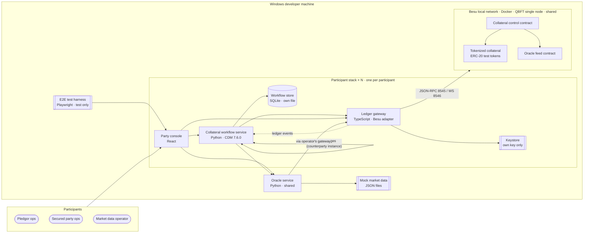

# Prototype architecture (sketch)

Part of `task-local-environment-setup` (goal `goal-architecture-design`). **Design only — nothing is built yet.**

The architecture is expressed in [FINOS CALM](https://github.com/finos/architecture-as-code) (Common Architecture
Language Model), schema release 1.2: [`prototype.architecture.json`](prototype.architecture.json). It validates with
`calm validate --strict` (CALM CLI 1.60.1): 0 errors, 0 warnings. It is generated by
[`generate_architecture.py`](generate_architecture.py) (`python generate_architecture.py prototype.architecture.json`).

Related: [test framework plan](testing.md) · [Windows setup instructions](../docs/setup-windows.md).
An interactive page with a flow selector is generated by [`render_architecture_page.py`](render_architecture_page.py)
(`python render_architecture_page.py prototype.architecture.json out.html`).

It follows the accepted ASRs and ADRs: CDM as the data layer, ledger neutrality (Besu first, Canton later),
on-chain asset identity, deterministic finality, off-chain dispute handling, and initial-margin segregation by a smart
contract (`wp-adr-im-segregation`). Scope constraint `nw-prototype-scope`: assumptions are acceptable where stated.

## Components



| Component | Type | Technology | Role |
|---|---|---|---|
| Participant stack (× N) | system | — | One per participant (pledgor, secured party, market operator): party console, workflow service, workflow store, ledger gateway and keystore. Each holds only its own party's books and key (`wp-adr-per-participant-services`) |
| Party console | web client | TypeScript, React + Vite *(assumption)* | Drives the flows for its participant; set by `PARTY_ID`, `ROLE` and `WALLET`; talks only to its own stack |
| Collateral workflow service | service, per participant | Python, FastAPI *(assumption)*, CDM 7.6.0 | Its party's agreements (IM CSA / CTA-SA), eligibility and haircuts with CDM functions, margin call lifecycle (issue, respond, dispute — the part CDM lacks, finding F2), its own movement instructions; exchanges calls, responses, return requests and default notices with the counterparty's instance |
| CDM 7.6.0 object model | data asset | CDM Python distribution *(assumption)* | Canonical data layer, extended locally with on-chain asset identity (finding B1) |
| Workflow store | database, per participant | SQLite, one file per party | Its party's agreements, calls, disputes, instructions, balances, asset registry (ISIN/CUSIP + DTI → network + token contract) |
| Oracle service | service, shared | Python | Run by the market operator. The oracle endpoints: prices / NAV and ratings for the workflow, signed updates and default notices to the on-chain feed |
| Mock market data | external system | JSON files | Stands in for NAV, price and rating providers |
| Ledger gateway | service, per participant | TypeScript (Node.js), ethers.js *(assumption)* | Ledger-neutral interface: signs with its own participant's key and submits transactions, waits for finality, reports events. Besu adapter first, Canton adapter later |
| Dev keystore | data asset, per participant | key files | That participant's key only (the market operator holds the oracle publisher and contract admin keys) |
| Besu local network | network, shared | Hyperledger Besu in Docker, single-node QBFT | Local stand-in for a permissioned network such as DTCC's private Besu network; deterministic finality |
| Tokenized collateral | contract | Solidity, ERC-20 with allow-list | Test tokens for a tokenized MMF and a tokenized US Treasury, carrying ISIN/CUSIP and DTI |
| End-to-end test harness | test only | Playwright *(assumption)* | Drives N console instances in parallel and asserts every CALM flow, including on-chain state |
| Collateral control contract | contract | Solidity | Holds pledged IM: pledge, return (both parties or secured party), enforce (secured party, after default) |
| Oracle feed contract | contract | Solidity | Latest price / NAV, rating and default status; written only by the oracle publisher |

## Endpoints (sketch)

| Service | Endpoint | Purpose |
|---|---|---|
| Collateral workflow service `:8000+n` (per participant) | `POST /api/v1/agreements` | Load a CDM agreement (IM CSA / CTA-SA elections, eligibility schedule) |
| | `POST /api/v1/margin-calls` | Issue an IM call (CDM `MarginCallIssuance`) |
| | `POST /api/v1/margin-calls/{id}/responses` | Agree, partially agree or dispute (CDM `MarginCallResponse`) |
| | `POST /api/v1/returns` · `POST /api/v1/returns/{id}/approvals` | Request and approve a return |
| | `POST /api/v1/defaults` | Declare a pledgor default |
| | `GET /api/v1/balances` | Collateral balances per agreement |
| | `POST /hooks/ledger-events` | Finalized ledger events from its own gateway |
| | `POST /peer/v1/messages` | Calls, responses, return requests and approvals, default notices from the counterparty's service |
| Oracle service `:8100` (shared) | `GET /oracle/v1/prices/{assetId}` · `GET /oracle/v1/ratings/{assetId}` | Valuation and eligibility data |
| | `PUT /oracle/v1/market-data/{assetId}` | Market operator changes mock NAV, price or rating |
| | `POST /oracle/v1/publish` | Push current prices and ratings on-chain |
| | `POST /oracle/v1/default-notices` | Relay a default notice to the on-chain feed |
| Ledger gateway `:8200+n` (per participant) | `POST /ledger/v1/instructions` | Pledge, return approval or enforce, signed with its own key |
| | `POST /ledger/v1/oracle-updates` | Write to the oracle feed contract (operator's gateway only) |
| | `GET /ledger/v1/positions/{account}` | Token balances and pledges |

## Flows (in the CALM file)

1. **Initial margin call and on-chain pledge** — the secured party's service sends the call to the pledgor's service;
   the response (dispute stays off-chain) goes back; the pledgor's gateway signs `pledge()`; both stacks record the
   finalized event.
2. **Oracle update** — mock data → oracle service → gateway → oracle feed contract.
3. **Collateral revaluation and top-up** — operator lowers a NAV, the workflow finds a shortfall, the secured party
   issues a top-up call (then flow 1).
4. **Return** — the pledgor's request goes to the secured party's service; the secured party's gateway signs
   `returnPledge()`; both stacks update.
5. **Default and enforcement** — default notice to the pledgor's service and the oracle feed; the secured party's
   gateway signs `enforce()`; tokens go to the secured party.

## Running N participants

Each participant runs its own stack (`wp-adr-per-participant-services`): party console, collateral workflow service,
workflow store, ledger gateway and keystore. Instance *n* uses ports `5173+n`, `8000+n` and `8200+n` and the store
`./data/<party-id>.db`, for example:

```
npm run stack -- --party BANK-A --role pledgor       --n 1   # console 5174, service 8001, gateway 8201
npm run stack -- --party BANK-B --role secured-party --n 2   # console 5175, service 8002, gateway 8202
npm run stack -- --party MKT    --role market-operator --n 0 # console 5173, service 8000, gateway 8200
```

A participant directory (`participants.json`) maps each party ID to its service URL, so a workflow service can reach
its counterparty's instance. The oracle service, the mock market data, the Besu node and the contracts run once and are
shared. The end-to-end harness starts N stacks and drives their consoles in parallel browser contexts.

## Local environment on Windows

Step-by-step instructions: [`../docs/setup-windows.md`](../docs/setup-windows.md).


- Docker Desktop with the WSL2 backend, running a Besu container with a single-node QBFT genesis.
- Python 3 for the collateral and oracle services; Node.js for the ledger gateway and the Solidity toolchain
  (Hardhat, *assumption*) that compiles and deploys the contracts to Besu.
- **Besu simulator choice:** a real Besu node in Docker. EVM simulators such as Hardhat Network or Anvil are lighter but
  are not Besu; they could be used for fast contract unit tests.

## Assumptions

- A CDM 7.6.0 Python distribution is available and usable on Windows.
- FastAPI, ethers.js and Hardhat are suitable; any equivalent can replace them.
- Single-node QBFT is enough to illustrate deterministic finality. All participant gateways share the one Besu node;
  one node per participant is a later option.
- Workflow services talk directly to each other over HTTP; in production a messaging network would carry these messages.
- Smart-contract control satisfies IM segregation (`nw-assumption-contract-control`).
