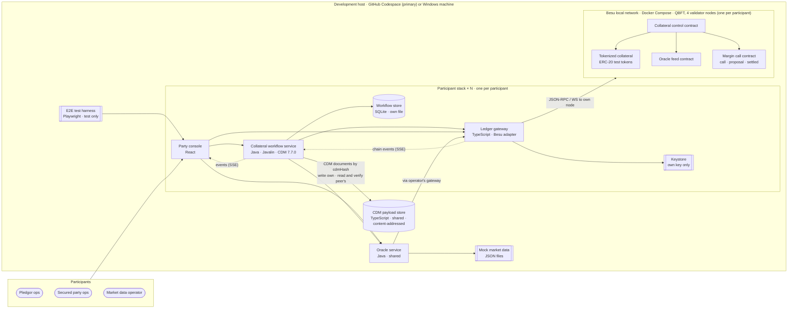

# Prototype architecture (sketch)

Part of `task-local-environment-setup` (goal `goal-architecture-design`). **Partially built** (`task-e2e-wiring`): the
IM and VM margin call lifecycles — issue, respond (full / partial / dispute), propose, accept / reject, settle, and
three-step returns — run live on the contracts, the ledger gateway, the collateral workflow service, the CDM payload
store and the console. The oracle service and flows 2, 3 and 5 below are design only. Component READMEs hold the
implemented interfaces: [`../gateway`](../gateway/README.md), [`../services/collateral`](../services/collateral/README.md),
[`../store`](../store/README.md), [`../contracts`](../contracts/README.md).

The architecture is expressed in [FINOS CALM](https://github.com/finos/architecture-as-code) (Common Architecture
Language Model), schema release 1.2: [`prototype.architecture.json`](prototype.architecture.json). It validates with
`calm validate --strict` (CALM CLI 1.40.0): 0 errors, 0 warnings. The file is edited by hand; its `adrs` list is
refreshed from the konspekt ADR waypoints by [`sync_adrs.py`](sync_adrs.py) (`python sync_adrs.py prototype.architecture.json`).

Related: [test framework plan](testing.md) · [GitHub Codespaces setup](../docs/setup/setup-codespaces.md) (primary) ·
[Windows setup instructions](../docs/setup/setup-windows.md).
An interactive page with a flow selector is generated by [`render_architecture_page.py`](render_architecture_page.py)
(`python render_architecture_page.py prototype.architecture.json out.html`).

It follows the accepted ASRs and ADRs: CDM as the data layer, ledger neutrality (Besu first, Canton later),
on-chain asset identity, deterministic finality, margin call state on-chain with negotiation off-chain
(`wp-adr-margin-call-state-onchain`), one stack per participant (`wp-adr-per-participant-services`), and
initial-margin segregation by a smart contract (`wp-adr-im-segregation`), CDM on its Java distribution
(`wp-adr-java-cdm-stack`), and CDM content carried off-chain in a content-addressed store anchored by the on-chain hash
(`wp-adr-cdm-payload-carrier`, review: proposed). Scope constraint `nw-prototype-scope`: assumptions are acceptable where stated.

## Components



| Component | Type | Technology | Role |
|---|---|---|---|
| Participant stack (× N) | system | — | One per participant (pledgor, secured party, market operator): party console, workflow service, workflow store, ledger gateway, keystore and a Besu validator node. Each holds only its own party's books and key (`wp-adr-per-participant-services`) |
| Party console | web client | TypeScript, React + Vite *(assumption)* | Drives the flows for its participant; set by `PARTY_ID`, `ROLE` and `WALLET`; talks only to its own stack |
| Collateral workflow service | service, per participant | Java 21, Javalin, CDM 7.7.0 Java + local extension `cdm-ext` (`wp-adr-java-cdm-stack`) | Its party's agreements (IM CSA / CTA-SA), eligibility and haircuts with CDM functions, margin call lifecycle (issue, respond, dispute, propose, decide, settle — the part CDM lacks, finding F2), its own movement instructions. Writes each step's CDM document (`MarginCallInstruction`, canonical Rune JSON) to the payload store under its keccak-256 hash, reads the counterparty's steps from the chain and the store, and folds all steps in chain order into one validated `MarginCallState` per call (`Create_MarginCallState`); both parties' folds converge. Relays chain events to its console over SSE |
| CDM 7.7.0 object model | data asset | `org.finos.cdm:cdm-java` 7.7.0 and the generated `cdmx` extension | Canonical data layer, extended locally with on-chain asset identity (finding B1) |
| Workflow store | database, per participant | SQLite, one file per party | Its party's agreements, calls, disputes, instructions, balances, asset registry (ISIN/CUSIP + DTI → network + token contract) |
| CDM payload store | database, shared | TypeScript (Node.js), files keyed by hash | The CDM document of every lifecycle step, stored under its keccak-256 hash — the same `cdmHash` the margin call contract records — and rejected if the body does not hash to its key. Per-document reader allowlist of the call's two counterparties; callers authenticate with a per-party bearer token; fails closed (`wp-adr-cdm-payload-carrier`) |
| Oracle service | service, shared | Java 21, Javalin | Run by the market operator. The oracle endpoints: prices / NAV and ratings for the workflow, signed updates and default notices to the on-chain feed |
| Mock market data | external system | JSON files | Stands in for NAV, price and rating providers |
| Ledger gateway | service, per participant | TypeScript (Node.js), viem | Ledger-neutral interface: signs with its own participant's key and submits transactions, waits for finality, serves a call's steps in chain order with their `cdmHash`, and pushes chain events over SSE from one `eth_subscribe` subscription. Besu adapter first, Canton adapter later |
| Dev keystore | data asset, per participant | key files | That participant's key only (the market operator holds the oracle publisher and contract admin keys) |
| Besu local network | network, one node per participant | Hyperledger Besu in Docker Compose, four QBFT validators | Local stand-in for a permissioned network such as DTCC's private Besu network; each participant's gateway uses its own node; deterministic finality; tolerates one node down |
| Tokenized collateral | contract | Solidity, ERC-20 with allow-list | Test tokens for a tokenized MMF and a tokenized US Treasury, carrying ISIN/CUSIP and DTI |
| End-to-end test harness | test only | Playwright *(assumption)* | Drives N console instances in parallel and asserts every CALM flow, including on-chain state |
| Collateral control contract | contract | Solidity | Holds pledged IM: pledge (only the accepted assets of an agreed call, up to the agreed amount), return (against an agreed return call), enforce (secured party, after default), close out (secured party, after default: apply to the amount owed, return the surplus), substitute (pledgor requests and settles, secured party consents), interest on cash collateral (secured party states and pays; pledgor pays a negative amount) |
| Margin call contract | contract | Solidity | Each call's state (issued, agreed, partially agreed, disputed, settled), collateral proposal state (proposed, accepted, rejected) with assets and quantities, amounts and deadline; every step's event carries the `cdmHash` of its CDM document (`CallIssued`, `CallAnswered`, `CollateralProposed`, `ProposalDecided`, `CallSettled`); each change signed by the acting party. Every node can read it (`nw-assumption-besu-visibility`) |
| Oracle feed contract | contract | Solidity | Latest price / NAV, rating and default status; written only by the oracle publisher |

## Endpoints

Collateral workflow service, ledger gateway and payload store: implemented routes, summarised here; the component
READMEs are the authority. Oracle service: design only.

| Service | Endpoint | Purpose |
|---|---|---|
| Collateral workflow service `:8000+n` (per participant) | `GET /api/v1/context` · `GET /api/v1/state` | Party, role, counterparty, tokens; its calls and their state |
| | `POST /api/v1/calls` | Issue a margin call (IM or VM; a return call for returns) |
| | `POST /api/v1/calls/{id}/response` | Agree in full, agree in part, or dispute |
| | `POST /api/v1/calls/{id}/proposal` · `POST /api/v1/calls/{id}/decision` | Propose collateral (one or more tokens) and accept or reject it |
| | `POST /api/v1/calls/{id}/pledge` · `POST /api/v1/calls/{id}/transfer` · `POST /api/v1/calls/{id}/return` | Settle: IM pledge into escrow, VM title transfer, return (`via` = `release` \| `transfer`) |
| | `GET /api/v1/calls/{id}/cdm-state` | The call's folded `MarginCallState` and its keccak `stateHash` |
| | `GET /api/v1/events` | Server-Sent Events: chain events relayed from its own gateway |
| CDM payload store `:8300` (shared) | `POST /store/v1/docs` · `GET /store/v1/docs/{hash}` | Write a step's CDM document under its keccak-256 hash; read it by the on-chain `cdmHash`. Bearer token per party; per-document reader allowlist |
| Oracle service `:8100` (shared, design only) | `GET /oracle/v1/prices/{assetId}` · `GET /oracle/v1/ratings/{assetId}` | Valuation and eligibility data |
| | `PUT /oracle/v1/market-data/{assetId}` | Market operator changes mock NAV, price or rating |
| | `POST /oracle/v1/publish` | Push current prices and ratings on-chain |
| | `POST /oracle/v1/default-notices` | Relay a default notice to the on-chain feed |
| Ledger gateway `:8200+n` (per participant) | `POST /ledger/v1/calls` · `POST /ledger/v1/calls/{id}/response` | Record a call or a response on-chain (state, amounts, `cdmHash`), signed with its own key |
| | `POST /ledger/v1/calls/{id}/proposals` · `POST /ledger/v1/calls/{id}/decision` | Record a collateral proposal (assets, quantities, `cdmHash`) or its acceptance / rejection (`cdmHash`) |
| | `POST /ledger/v1/calls/{id}/pledge` · `/transfer` · `/return` · `/return-transfer` | Settle with the settle step's `cdmHash`: IM pledge, VM transfer, IM release, VM transfer back |
| | `GET /ledger/v1/calls/{id}` · `GET /ledger/v1/calls/{id}/steps` | On-chain call state; the call's lifecycle steps in chain order with their `cdmHash` (fold input) |
| | `GET /ledger/v1/pledged` · `GET /ledger/v1/balance` | Escrowed and free token balances |
| | `GET /ledger/v1/events` | Server-Sent Events: one `eth_subscribe` subscription on its Besu node, fanned out |

## Flows (in the CALM file)

1. **Initial margin call, collateral proposal and on-chain pledge** — the secured party writes the call's CDM document
   to the payload store and records the call with its `cdmHash` on-chain; the pledgor's gateway pushes the event, and the
   pledgor's service fetches the document by hash, verifies it and folds it; the pledgor records its response (a disputed amount stays open,
   resolved off-chain) and a collateral proposal; the secured party checks the proposal against its own eligibility
   schedule and accepts or rejects it on-chain; the pledgor signs `pledge()` for the accepted assets, which the control
   contract checks against the call and the accepted proposal. Every step goes through the store and the chain the same
   way, and both parties end with an identical `MarginCallState`.
2. **Oracle update** — mock data → oracle service → gateway → oracle feed contract.
3. **Collateral revaluation and top-up** — operator lowers a NAV, the workflow finds a shortfall, the secured party
   issues a top-up call (then flow 1).
4. **Return** — the pledgor records a return call on-chain; the secured party agrees it through the response step and
   releases the escrowed tokens through `returnCollateral()` (VM: `returnByTransfer()`).
5. **Default and enforcement** — default notice to the oracle feed, which the pledgor's service learns of through its
   own gateway; the secured party's
   gateway signs `enforce()`; tokens go to the secured party.
6. **Close-out netting on default** (`flow-close-out-netting`, G15) — the secured party enters the Close-out Amount;
   its service builds the CDM `CloseOutStatement` (ISDA 2002 MA Section 6(e)) and the control contract applies the
   pledged collateral to the Early Termination Amount and returns the surplus to the pledgor.
7. **Substitution** (`flow-substitution`, G16) — the pledgor requests a substitution of pledged items, the secured
   party consents, and settlement moves the substitute into escrow and the originals back in one transaction; both
   services fold the three CDM steps to the same state.
8. **Interest on cash collateral** (`flow-interest-on-cash`, G17) — the secured party enters an Interest Period and
   the observed rate; its service builds the CDM `CollateralInterestStatement` on the pledgor's tUSD in escrow, and the
   control contract pays the Interest Amount to the pledgor (a negative amount is paid by the pledgor).
9. **Amendment of agreement terms** (`flow-agreement-amendment`) — either party proposes a new pledgor Minimum
   Transfer Amount and haircut changes as a CDM `CollateralAgreementAmendment` (cdm-ext, over CDM's
   `Create_AgreementEvent`; baseline: CDM's sample 2018 NY law IM CSA), chained from the pair's agreement hash; the
   other party consents on-chain, the control contract applies the haircuts to the pair, and both services fold the
   agreed amendments to the same terms.
10. **Margin call cancellation** (`flow-call-cancellation`) — the calling party withdraws an unanswered call; once the
    call is answered and not settled, either party requests its cancellation and the other accepts or refuses
    (ISO 20022 colr.005 and colr.006). An accepted cancellation voids a proposal not yet delivered; both services fold
    the cdm-ext steps to the `Cancelled` status. The rules are assumptions to be confirmed by a business SME
    (`task-sme-call-cancellation-rules`).
11. **Replacement of a cancelled call** (`flow-call-replacement`) — the calling party issues a corrected call that
    names the call it cancelled. The contract links the two calls both ways (one replacement per cancelled call, same
    caller, called party and kind), and the cdm-ext IssueCall step carries `replacesCall`, checked by
    `ReplacementAllowed` against the cancelled call's state. The rules are assumptions awaiting the SME (question 5 of
    `task-sme-call-cancellation-rules`).
12. **Settlement netting** (`flow-settlement-netting`) — the day's agreed VM calls, VM returns and Interest Amounts
    held for netting between the two parties settle by one transfer of tUSD from the party that owes the net
    (`CollateralControl.settleNetted`). cdm-ext `Create_SettlementNetting` gives the net in a
    `SettlementNettingStatement` under the agreement's `netInterestWithMarginCalls` election, and each call's SettleCall
    step names the netting. Initial margin does not net. The rules are assumptions awaiting a business SME
    (`task-sme-settlement-netting-rules`).
13. **Collateral allocation** (`flow-allocation`) — on an agreed IM or VM call, the called party's service suggests a
    basket that covers the agreed amount: cdm-ext `AllocateCollateral` takes the party's eligible holdings in its
    ranking order (registry order by default), at the oracle feed prices and the pair's haircuts, and rounds the last
    one up to whole units. Nothing is recorded on-chain; the console fills the proposal basket and the party proposes
    it as before. Concentration limits are not applied. The default ranking awaits a business SME
    (`task-sme-allocation-ranking`).
14. **Reconciliation** (`flow-reconciliation`) — either party reconciles its trade portfolio with the counterparty's:
    each workflow service holds CDM sample TradeStates and its own valuation of each, the two services exchange their
    `PortfolioSnapshot`s directly (`service-to-counterparty-service`), and each commits its snapshot hash and the hash
    of the cdm-ext `ReconcilePortfolios` result to the portfolio reconciliation contract; the run is Agreed when the
    result hashes match. Breaks are trades missing at one party, differing key economic terms and valuations outside
    the tolerance. The called party can dispute an issued call citing the run (a CDM Dispute). A party also reconciles
    its stored MarginCallStates with the chain on request (cdm-ext `ReconcileWithLedger`: status, called and agreed
    amounts, and the pledgor's escrow by token as its settled records build it against the control contract's). Key terms, tolerance and cadence await a business SME (`task-sme-reconciliation-rules`).

## Running N participants

Each participant runs its own stack (`wp-adr-per-participant-services`): party console, collateral workflow service,
workflow store, ledger gateway and keystore. Instance *n* uses ports `5173+n`, `8000+n` and `8200+n` and the store
`./data/<party-id>.db`, for example:

```
npm run stack -- --party BANK-A --role pledgor       --n 1   # console 5174, service 8001, gateway 8201
npm run stack -- --party BANK-B --role secured-party --n 2   # console 5175, service 8002, gateway 8202
npm run stack -- --party MKT    --role market-operator --n 0 # console 5173, service 8000, gateway 8200
```

Each stack's gateway connects to that participant's Besu node (`mkt` 8545, `bank-a` 8547, `bank-b` 8549, `bank-c` 8551).
The CDM payload store, the oracle service, the mock market data and the contracts run once and are shared. The end-to-end harness starts N stacks and drives their consoles in parallel browser contexts.

## Development environment

Primary: GitHub Codespaces from [`../.devcontainer/devcontainer.json`](../.devcontainer/devcontainer.json)
(`wp-adr-cloud-dev-environment`), instructions in [`../docs/setup/setup-codespaces.md`](../docs/setup/setup-codespaces.md).
Local Windows machine: [`../docs/setup/setup-windows.md`](../docs/setup/setup-windows.md).


- Docker (Docker-in-Docker in the codespace; Docker Desktop with WSL2 on Windows), running four Besu validator nodes
  with Docker Compose ([`../besu/`](../besu/)).
- Java 21 and Maven for the collateral and oracle services (Javalin) and the CDM extension; Node.js for the ledger gateway and the Solidity toolchain
  (Hardhat, *assumption*) that compiles and deploys the contracts to Besu.
- **Besu simulator choice:** a real Besu node in Docker. EVM simulators such as Hardhat Network or Anvil are lighter but
  are not Besu; they could be used for fast contract unit tests.

## Assumptions

- Flows mimic real collateral operations as closely as possible (`nw-mimic-real-flows`); simplifications are
  stated here.
- Two-way initial margin: the design allows it (roles are per pledge); the flows show one direction for now
  (`task-two-way-initial-margin`).

- Javalin, viem and Hardhat are suitable; any equivalent can replace them. CDM runs on its Java distribution
  (`wp-adr-java-cdm-stack`; the Python distribution was tried and retired, defects D14–D16).
- Four QBFT validators on one machine are enough to illustrate deterministic finality and per-participant nodes.
  Participants beyond the four default ones use an existing node or join as non-validators.
- Workflow services do not call each other. CDM content passes through one shared payload store keyed by the on-chain
  hash, authenticated with a per-party bearer token (`wp-adr-cdm-payload-carrier`). In production: mutual TLS or signed
  requests, and a shared content-addressed store or IPFS with access control, or per-party stores.
- Every Besu node can read margin call data (`nw-assumption-besu-visibility`); privacy is examined in `task-onchain-privacy`.
- Smart-contract control satisfies IM segregation (`nw-assumption-contract-control`).
