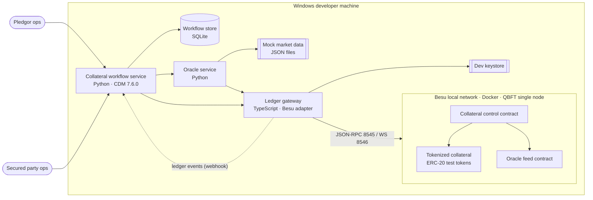

# Prototype architecture (sketch)

Part of `task-local-environment-setup` (goal `goal-architecture-design`). **Design only — nothing is built yet.**

The architecture is expressed in [FINOS CALM](https://github.com/finos/architecture-as-code) (Common Architecture
Language Model), schema release 1.2: [`prototype.architecture.json`](prototype.architecture.json). It validates with
`calm validate --strict` (CALM CLI 1.60.1): 0 errors, 0 warnings.

It follows the accepted ASRs and ADRs: CDM as the data layer, ledger neutrality (Besu first, Canton later),
on-chain asset identity, deterministic finality, off-chain dispute handling, and initial-margin segregation by a smart
contract (`wp-adr-im-segregation`). Scope constraint `nw-prototype-scope`: assumptions are acceptable where stated.

## Components

| Component | Type | Technology | Role |
|---|---|---|---|
| Collateral workflow service | service | Python, FastAPI *(assumption)*, CDM 7.6.0 | Agreements (IM CSA / CTA-SA), eligibility and haircuts with CDM functions, margin call lifecycle (issue, respond, dispute — the part CDM lacks, finding F2), movement instructions for agreed amounts |
| CDM 7.6.0 object model | data asset | CDM Python distribution *(assumption)* | Canonical data layer, extended locally with on-chain asset identity (finding B1) |
| Workflow store | database | SQLite | Agreements, calls, disputes, instructions, balances, asset registry (ISIN/CUSIP + DTI → network + token contract) |
| Oracle service | service | Python | The oracle endpoints: prices / NAV and ratings for the workflow, signed updates and default notices to the on-chain feed |
| Mock market data | external system | JSON files | Stands in for NAV, price and rating providers |
| Ledger gateway | service | TypeScript (Node.js), ethers.js *(assumption)* | Ledger-neutral interface: signs and submits transactions, waits for finality, reports events. Besu adapter first, Canton adapter later |
| Dev keystore | data asset | key files | Test account keys: pledgor, secured party, oracle publisher, contract admin |
| Besu local network | network | Hyperledger Besu in Docker, single-node QBFT | Local stand-in for a permissioned network such as DTCC's private Besu network; deterministic finality |
| Tokenized collateral | contract | Solidity, ERC-20 with allow-list | Test tokens for a tokenized MMF and a tokenized US Treasury, carrying ISIN/CUSIP and DTI |
| Collateral control contract | contract | Solidity | Holds pledged IM: pledge, return (both parties or secured party), enforce (secured party, after default) |
| Oracle feed contract | contract | Solidity | Latest price / NAV, rating and default status; written only by the oracle publisher |

## Endpoints (sketch)

| Service | Endpoint | Purpose |
|---|---|---|
| Collateral workflow service `:8000` | `POST /api/v1/agreements` | Load a CDM agreement (IM CSA / CTA-SA elections, eligibility schedule) |
| | `POST /api/v1/margin-calls` | Issue an IM call (CDM `MarginCallIssuance`) |
| | `POST /api/v1/margin-calls/{id}/responses` | Agree, partially agree or dispute (CDM `MarginCallResponse`) |
| | `POST /api/v1/returns` · `POST /api/v1/returns/{id}/approvals` | Request and approve a return |
| | `POST /api/v1/defaults` | Declare a pledgor default |
| | `GET /api/v1/balances` | Collateral balances per agreement |
| | `POST /hooks/ledger-events` | Finalized ledger events from the gateway |
| Oracle service `:8100` | `GET /oracle/v1/prices/{assetId}` · `GET /oracle/v1/ratings/{assetId}` | Valuation and eligibility data |
| | `POST /oracle/v1/publish` | Push current prices and ratings on-chain |
| | `POST /oracle/v1/default-notices` | Relay a default notice to the on-chain feed |
| Ledger gateway `:8200` | `POST /ledger/v1/instructions` | Pledge, return or enforce |
| | `POST /ledger/v1/oracle-updates` | Write to the oracle feed contract |
| | `GET /ledger/v1/positions/{account}` | Token balances and pledges |

## Flows (in the CALM file)

1. **Initial margin call and on-chain pledge** — call, response (dispute stays off-chain), valuation and eligibility,
   pledge instruction, `pledge()` on Besu, event back to the workflow.
2. **Oracle update** — mock data → oracle service → gateway → oracle feed contract.
3. **Return** — request, approval, `returnPledge()`, balance update.
4. **Default and enforcement** — default notice → oracle feed → `enforce()` → tokens to the secured party.

## Local environment on Windows (to be set up later)

- Docker Desktop with the WSL2 backend, running a Besu container with a single-node QBFT genesis.
- Python 3 for the collateral and oracle services; Node.js for the ledger gateway and the Solidity toolchain
  (Hardhat, *assumption*) that compiles and deploys the contracts to Besu.
- **Besu simulator choice:** a real Besu node in Docker. EVM simulators such as Hardhat Network or Anvil are lighter but
  are not Besu; they could be used for fast contract unit tests.

## Assumptions

- A CDM 7.6.0 Python distribution is available and usable on Windows.
- FastAPI, ethers.js and Hardhat are suitable; any equivalent can replace them.
- Single-node QBFT is enough to illustrate deterministic finality.
- Smart-contract control satisfies IM segregation (`nw-assumption-contract-control`).
