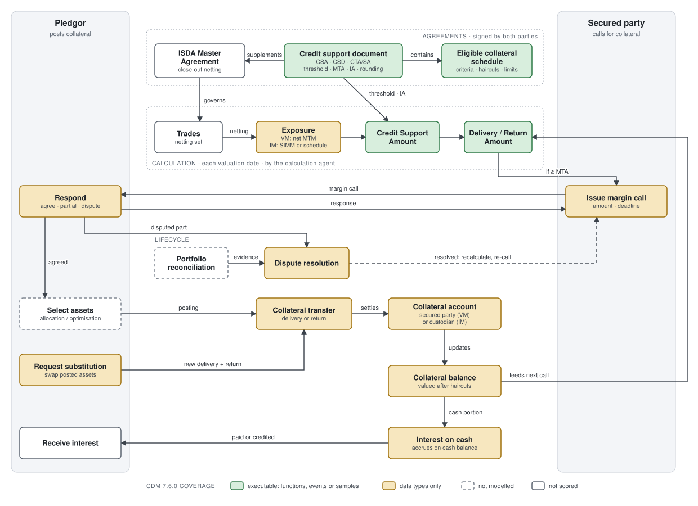

# Collateral management conceptual model — ISDA credit support documents

Part of `task-cdm-current-state-analysis` (goal `goal-data-cdm-taxonomies-specs`). Box colours are the coverage
scores from [`cdm-csa-coverage-matrix.md`](cdm-csa-coverage-matrix.md) (CDM release 7.6.0, commit `f685b4b`).



The pledgor and the secured party are roles, not fixed firms. Under a two-way VM CSA they swap on each call,
depending on which side is out of the money. Under IM, both parties post to each other at the same time into
segregated custodian accounts.

## The four flows

- **Netting.** The master agreement puts all trades into one netting set. The calculation agent nets their
  mark-to-market into one exposure (VM), or computes IM with SIMM or the standardised schedule.
- **Calling and negotiating.** Exposure plus the Independent Amount, minus the threshold and the current collateral
  balance, gives a Delivery or Return Amount. If it reaches the MTA, the secured party issues a call. The pledgor
  agrees in full, agrees in part, or disputes. A disputed part goes through reconciliation and recalculation, then a
  new call.
- **Posting.** For the agreed amount, the pledgor picks assets that pass the eligibility schedule and transfers them
  into the collateral account. Substitution swaps assets already posted for new ones.
- **Feedback.** Each settled transfer updates the collateral balance, valued after haircuts. That balance is
  subtracted in the next calculation. Interest accrues on cash collateral and is paid to the pledgor or added to the
  balance.

## Where CDM stops

CDM can execute the agreement side and the amount calculation (green). Everything from the margin call onwards
exists only as data types (amber), with no function or business event connecting the steps (finding F2 in the
matrix). Asset selection and portfolio reconciliation are not modelled (dashed).

## Not shown

- Triparty agents, CCP margin, repo (GMRA) and securities lending (GMSLA): `task-cdm-collateral-other-agreements`.
- Reuse or rehypothecation of posted collateral, close-out on default, and regulatory reporting.

## Regenerating the diagram

The SVG is generated by `diagrams/collateral_model_svg.py` (Python 3, no dependencies). Box positions, labels,
coverage classes and arrows are defined at the top of the script:

```
python3 docs/analysis/diagrams/collateral_model_svg.py docs/analysis/collateral-conceptual-model
mv docs/analysis/collateral-conceptual-model.static.svg docs/analysis/collateral-conceptual-model.svg
rm docs/analysis/collateral-conceptual-model.themed.svg
```
