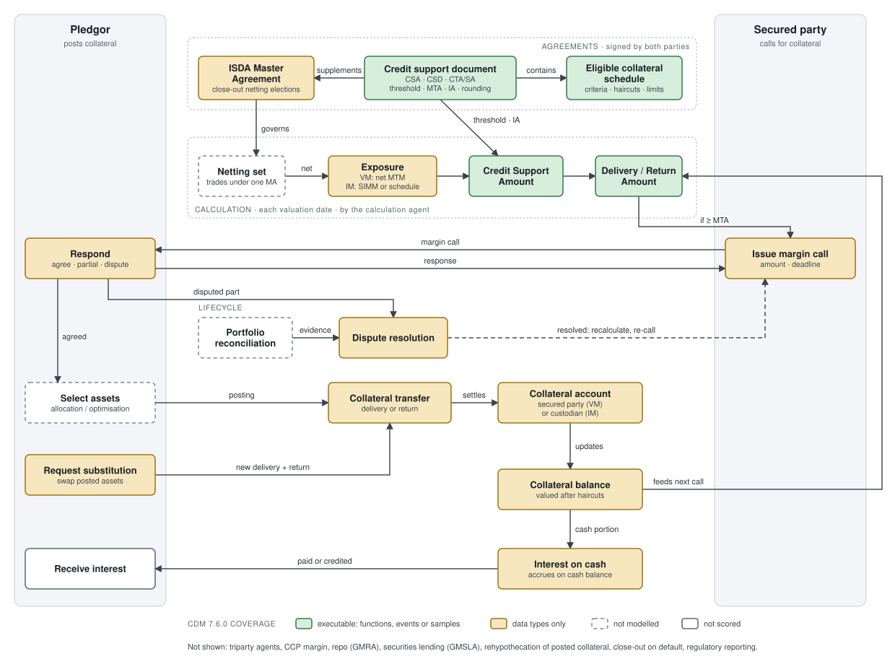
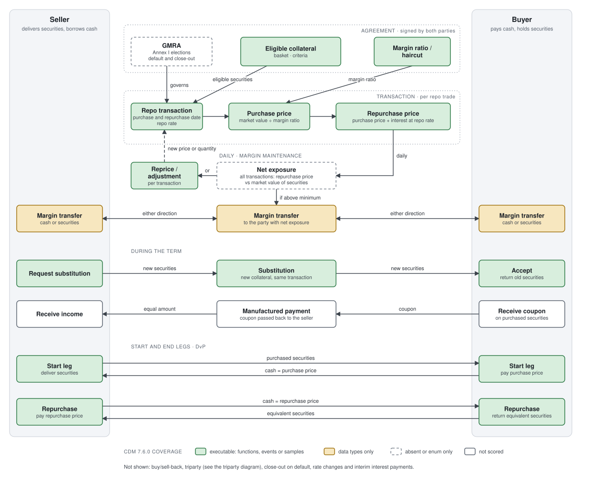
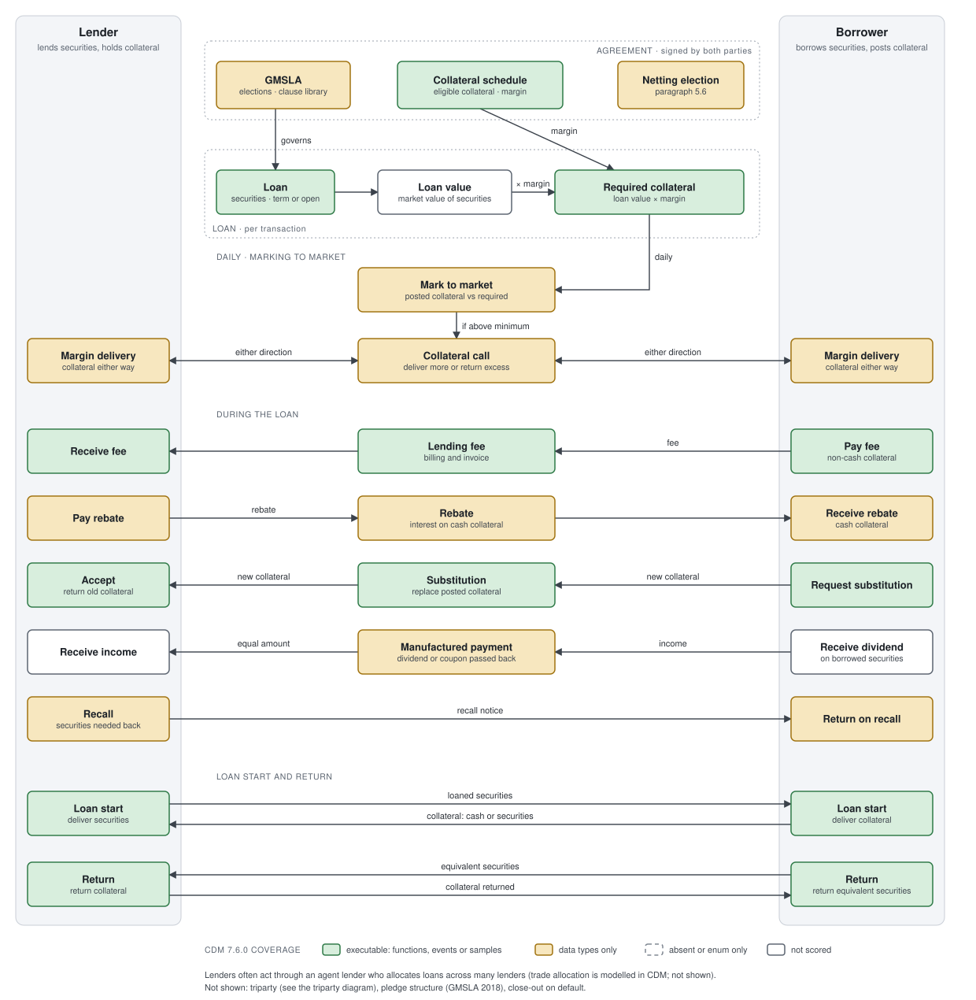
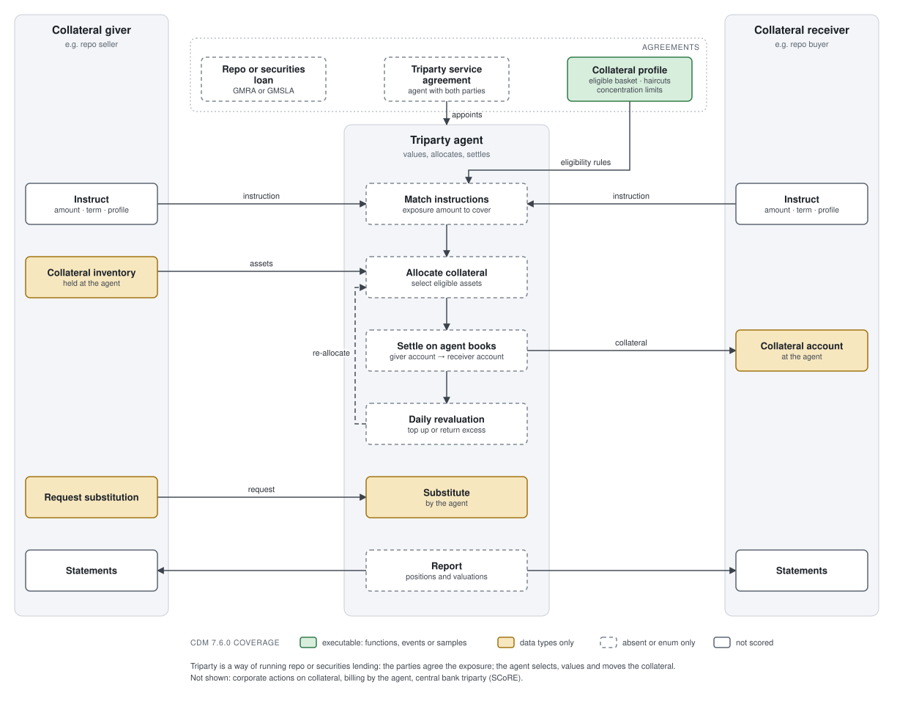
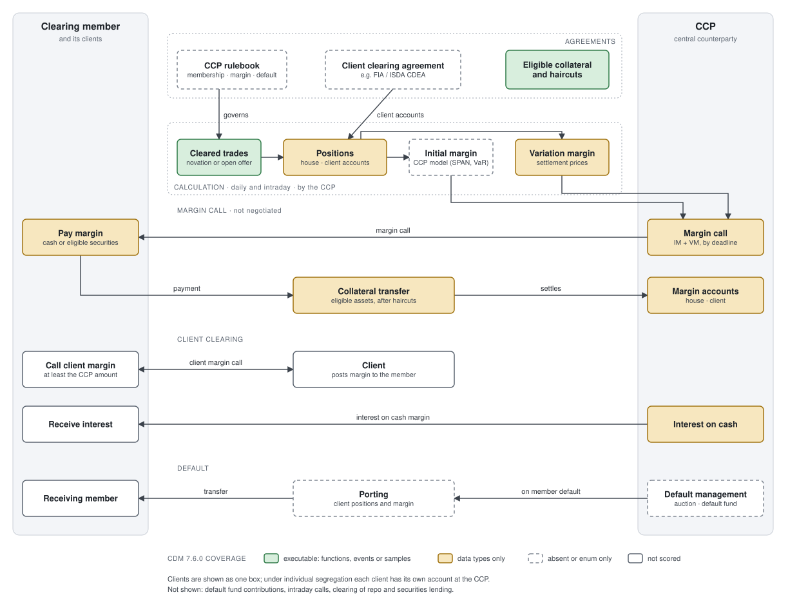

# Collateral flows by agreement family

Part of `task-cdm-collateral-other-agreements` (goal `goal-data-cdm-taxonomies-specs`). One flow diagram per
agreement family, drawn on the same layout as the ISDA CSA model: parties as lanes on the left and right, shared
objects in the middle. Box colours are the CDM 7.6.0 coverage scores from
[`cdm-csa-coverage-matrix.md`](cdm-csa-coverage-matrix.md) and
[`cdm-other-agreements-coverage-matrix.md`](cdm-other-agreements-coverage-matrix.md): green = executable (score
3–5), amber = data types only (2), dashed = absent or enum only (0–1), white = not scored.

| Family | Parties | Margin mechanism | Negotiated? |
|---|---|---|---|
| [ISDA CSA](#isda-csa) | pledgor, secured party (roles swap under a two-way VM CSA) | call for the Delivery / Return Amount on the netted exposure | yes: agree, partly agree, dispute |
| [Repo (GMRA)](#repo-gmra) | seller, buyer | margin transfer on net exposure across all transactions, or reprice / adjust one transaction | by agreement between the parties |
| [Securities lending (GMSLA)](#securities-lending-gmsla) | lender, borrower | daily marking to market of the loan against posted collateral | by agreement between the parties |
| [Triparty](#triparty) | collateral giver, collateral receiver, triparty agent | agent revalues daily and re-allocates | no: the agent applies the collateral profile |
| [CCP margin](#ccp-margin) | clearing member (and clients), CCP | CCP calls IM (own model) + VM (settlement prices) | no |

## ISDA CSA



Described in [`collateral-conceptual-model.md`](collateral-conceptual-model.md).

## Repo (GMRA)



The seller delivers securities against the purchase price and later pays the repurchase price for equivalent
securities. Margin is kept on the net exposure across all transactions under the GMRA, by margin transfers in either
direction, or by repricing or adjusting single transactions. Coupons paid on the securities during the term go back
to the seller.

**Where CDM stops.** The transaction lifecycle is executable: start and end legs, reprice, adjustment and
substitution have functions and test data. The GMRA has no elections in CDM, and net exposure is not calculated.

## Securities lending (GMSLA)



The lender delivers securities and the borrower posts collateral worth the loan value times the margin. The loan is
marked to market daily and collateral moves either way. The borrower pays a fee on non-cash collateral; on cash
collateral the lender pays a rebate. Dividends on borrowed securities are passed back as manufactured payments. The
lender can recall the securities.

**Where CDM stops.** Loan start, return, substitution and billing are executable. The GMSLA elections and clause
library exist but nothing uses them. Marking to market, rebate and recall are data types only.

## Triparty



Triparty is a way of running repo or securities lending. The two parties agree only the exposure amount and the
collateral profile and send instructions to the agent. The agent selects eligible assets from the giver's
inventory, settles them on its own books, revalues them daily, re-allocates or substitutes as needed, and reports
to both parties.

**Where CDM stops.** Only the collateral profile (eligibility rules) is executable. CDM has a triparty agent party
role and nothing for the agent's processing.

## CCP margin



The CCP holds cleared positions in house and client accounts, calculates initial margin with its own model and
variation margin from settlement prices, and calls the clearing member. The call is not negotiated. The member pays
in cash or eligible securities and calls margin from its clients. On a member default the CCP ports client positions
to another member.

**Where CDM stops.** Clearing a trade (novation or open offer) is executable. The margin side is data types only,
and the CCP margin model, default management and porting are absent.

## Regenerating the diagrams

```
python3 docs/analysis/diagrams/collateral_diagrams.py docs/analysis/diagrams
```

The script holds one model per family (lanes, groups, boxes with coverage class, arrows, footnotes). Box scores
must be kept in line with the coverage matrices.
