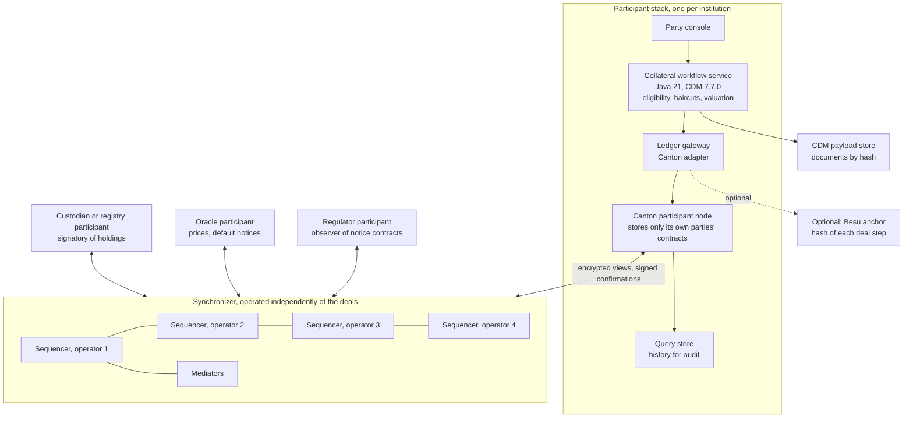
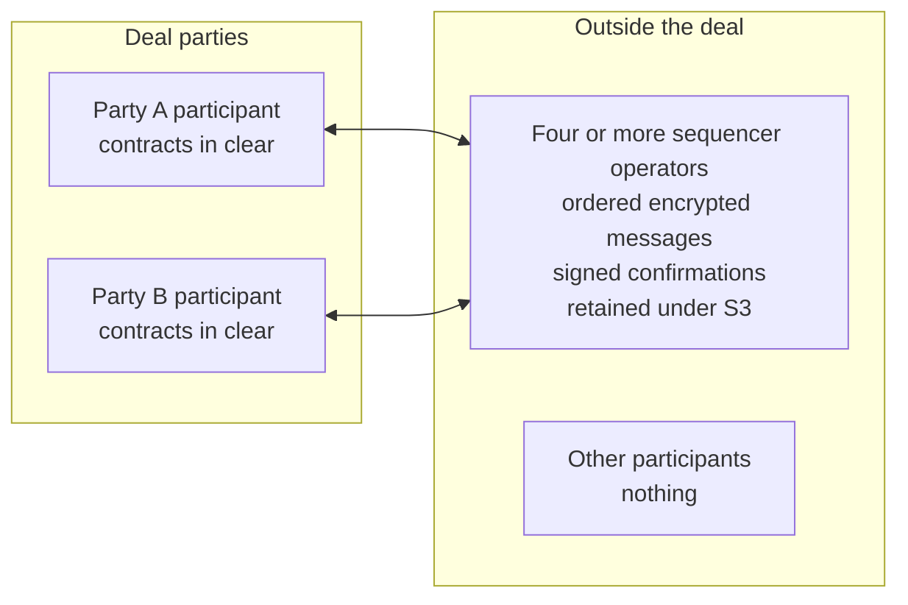
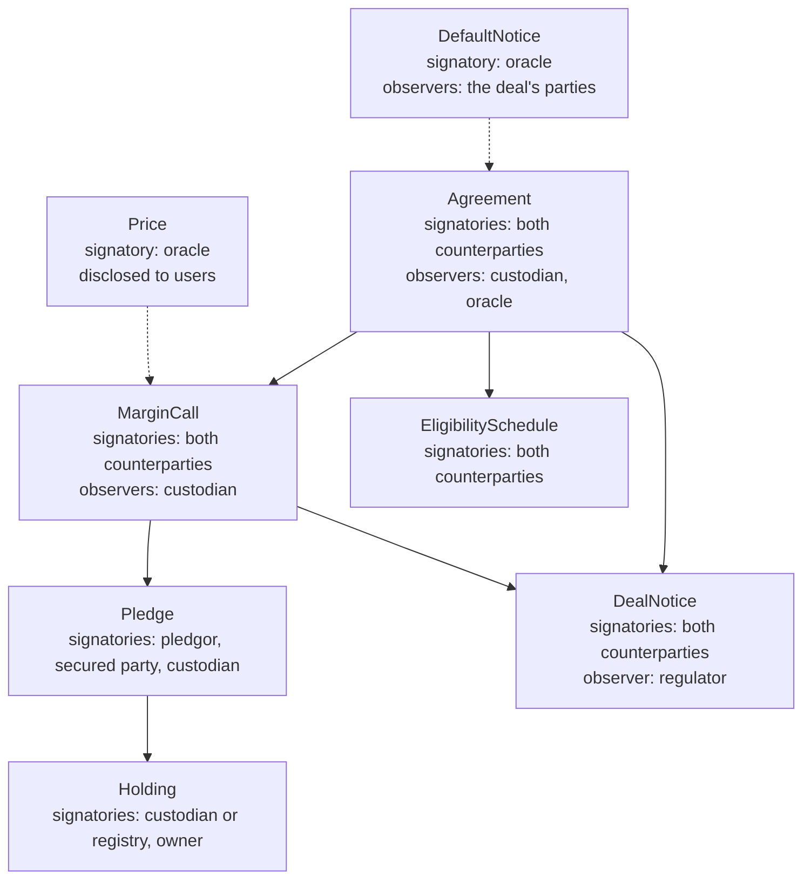
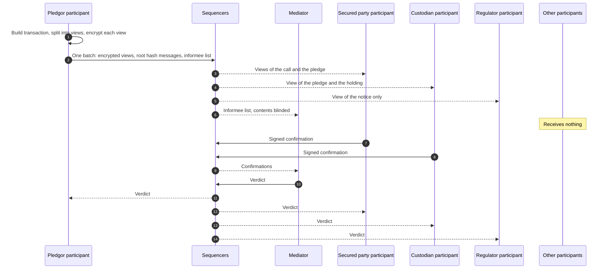
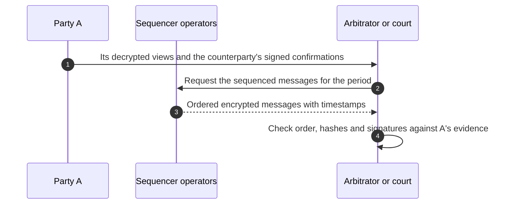
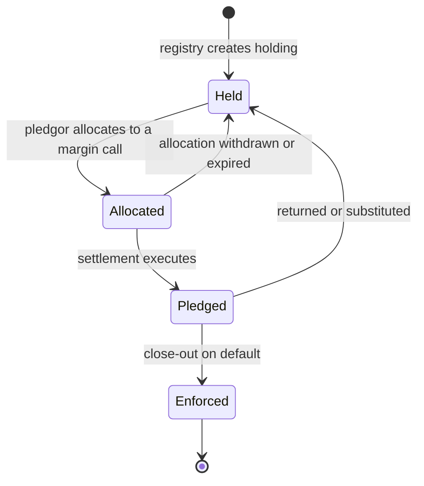
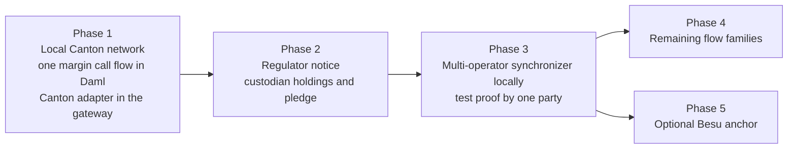

# On-chain privacy design, Canton version: deal contracts on Canton with an independent multi-operator synchronizer

Output for `task-onchain-privacy` and `investigation-onchain-data-protection`. Alternative version of
[`onchain-privacy.md`](onchain-privacy.md), which takes a custom design on Besu as its main path. This version takes
Canton as the main path. The project owner asked for both versions; neither is selected.

| | |
|---|---|
| Status | Draft proposal, 2026-11-24 (UTC). Nothing in this document is implemented. No Canton or Daml code exists in the repository. |
| Decides | Nothing yet. Section 15 lists the decisions the project owner has to take. |
| Inputs | `nw-canton-multi-operator-synchronizer`, `nw-visibility-rule-deal-participants`, `nw-constraint-immutability-beyond-deal-parties`, `nw-requirements-onchain-privacy`, `wp-adr-prototype-ledgers`, `docs/analysis/bank-use-of-besu.md` |

**How to read the claims.**

- **Observed**: read from this repository on the branch `investigation/onchain-data-protection`.
- **Owner**: stated by the project owner in the investigation's source excerpts.
- **Documented**: read from Canton, Digital Asset, FINOS or Canton Foundation documentation on 2026-11-23 and
  2026-11-24. Canton was not run for this document.
- **Proposed**: design content written by the maintainer. Not built, run or measured.

## 1. Problem

Every participant in the prototype runs a QBFT validator node and holds the full Besu chain state. The twelve
contracts in `contracts/contracts/` emit counterparty addresses, amounts and credit events in clear (Observed). The
full leak inventory is in [`onchain-privacy.md`](onchain-privacy.md), section 1. The most sensitive items are per-member
CCP margin statements, default notices naming both parties, close-out amounts, triparty deposits, and
`OracleFeed.DefaultPublished(party, inDefault)`.

## 2. Why Canton as the main path

- **Canton is already the project's second ledger.** `wp-adr-prototype-ledgers` (accepted) sets Besu first and Canton
  second behind the same ledger-neutral interface, and names the Canton token standard CIP-56 as the token model the
  interface must cover (Observed).
- **Its privacy model matches the visibility rule without added cryptography.** Canton sends each part of a
  transaction only to the participants hosting parties entitled to it, and other participants do not learn that the
  transaction happened (Documented).
- **The immutability objection is removed by a deployment requirement.** The owner requires an independent
  multi-operator synchronizer and stated that this removes the objection
  (`nw-canton-multi-operator-synchronizer`).
- **It exists.** The design needs no new protocol, no proof system and no key scheme of the project's own.
- **The collateral ecosystem uses it.** The DTCC tokenization service runs on Canton Network with CIP-56
  (`wp-adr-prototype-ledgers`, Observed in the record). CIP-56 names collateral management among the uses of its
  settlement interfaces (Documented).

## 3. Requirements and how this version treats them

Requirement numbers are those of [`onchain-privacy.md`](onchain-privacy.md), section 2.

| # | Requirement | In this version |
|---|---|---|
| R1 | Deal participants see all deal data | **Met.** Every role is a signatory or observer of the deal's contracts (section 6). |
| R2 | A regulator sees part of it | **Met.** A separate notice contract with the regulator as observer (section 8). |
| R3 | Other participants see none of it | **Met for participants.** Synchronizer operators see recipients and message sizes (section 7). |
| R4, R10 | Record and evidence held beyond the deal's parties | **Met on condition** of the synchronizer requirements in section 5. |
| R5 | Public logic | **Partly met.** The Daml source is published in this repository and a package is identified by a hash of its content. A non-participant cannot check which package a given deal ran. |
| R6 | Keys distributed offline | **Replaced.** Canton encrypts each view to the recipients' participant keys and sends the key with the message (Documented). No deal keys are exchanged offline. |
| R7 | Rules over hidden values enforced on-chain by proofs | **Not met; replaced.** Every stakeholder's participant re-executes the same Daml and signs a confirmation. No node outside the deal checks a rule. |
| R8 | 47 workflows, thousands of rules, asset types in the high hundreds | **Met by structure.** Daml carries the lifecycle and asset movement; CDM rule evaluation stays in the Java workflow service (section 10). Not measured. |
| R9 | The data flow is visible to every participant | **Not met.** Hiding the existence of a transaction from non-participants is a Canton design goal. Section 12 gives an optional anchor that restores a visible flow. |
| R11 | Single encumbrance | **Met by the ledger.** A holding contract can be consumed once (section 9). |
| R12 | Timeliness | No proof generation. Confirmation latency not measured. |
| R13 | Credit events stay inside the deal | **Met for participants.** Operators can see message bursts between two participants. |
| R14 | Proof by one party | **Not verified.** Needs a test (section 14, phase 3). |
| R15 | Independence between deals | **Met.** An unresponsive participant blocks only transactions that need its confirmation (Documented, signatory confirmation policy). |
| R16 | Change of parties | **Met by the ledger.** Archive the contract and create a new one with the new parties. Earlier contracts are not sent to the new party. |
| R17 | Retention and erasure | **Met by configuration.** Each node operator sets a pruning schedule (Documented). Retention needed for R4 and erasure pull in opposite directions (section 5). |
| R18 | Finality stated precisely | A transaction is final on the ledger when the mediator's verdict is sequenced. That is not legal settlement finality. |
| R19 | Link to the real asset | **Met where the custodian or registry is a signatory of the holding** (section 9). |

R5, R7 and R9 are the requirements this version gives up or weakens. Whether the owner holds them independently of
the custom design is open (section 15, item 1).

## 4. Architecture

Proposed. The participant stack keeps its current shape (`architecture/README.md`): party console, collateral workflow
service with CDM 7.7.0, workflow store, ledger gateway. The Besu validator node is replaced by a Canton participant
node, and the Solidity contracts by Daml templates.



| Component | Change from today |
|---|---|
| Party console, workflow service, workflow store | None. CDM rule evaluation stays in Java. |
| Ledger gateway | A Canton adapter beside `gateway/src/besu.ts`, behind the same interface. It submits commands and reads the party's transactions through the participant's Ledger API. |
| Canton participant node | New. One per institution, hosting that institution's parties. |
| Synchronizer | New. Sequencers and mediators, run by several operators (section 5). |
| Daml package | New. Replaces the twelve Solidity contracts (section 13). |
| CDM payload store | Kept. The contract carries the document hash; the body stays off-ledger, which keeps personal data out of the ledger. |
| Besu network | Not used by this design, except for the optional anchor (section 12) and for assets that stay on Besu (section 9). |

## 5. Synchronizer requirements

The owner's condition (`nw-canton-multi-operator-synchronizer`) carries R4 and R10. What the documentation supports:
confirmations are signed and sequenced; ledger data lives on the participant nodes and on the sequencer backend; a
participant can replay missing data from the synchronizer; the sequencer can run as a Byzantine fault tolerant set;
pruning is a schedule each operator sets.

Proposed requirements on the deployment:

| # | Requirement | Reason |
|---|---|---|
| S1 | At least four sequencer nodes run by at least four distinct operators. | Tolerates one faulty or dishonest operator under the usual one-third bound. The exact bound of Canton's ordering protocol was not checked. |
| S2 | No set of operators that are all parties to the same deal runs one third or more of the sequencers. | Otherwise the deal's parties could reorder or withhold their own deal's messages. |
| S3 | Sequencer history is retained for the regulatory retention period, under a schedule fixed in the network rulebook. | The sequenced history is the record outside the parties. Early pruning removes it. |
| S4 | Mediators are run by operators that meet S1 and S2. | The mediator decides each transaction's outcome. |
| S5 | Operators are non-trading institutions, or the metadata in section 7 is accepted as visible to them. | Sequencers see recipient lists and message sizes; mediators see which parties are informees of each view (Documented). |



Tension to settle: R4 needs history retained; R17 and data-protection law need it deleted eventually. S3 sets one
period for both. The length of that period is open (section 15, item 4).

Two ways to obtain such a synchronizer, neither assessed in depth: a private synchronizer run by a consortium of
operators, or the Canton Network's Global Synchronizer, which runs sequencers across its super-validators
(Documented). Open (section 15, item 3).

## 6. Deal contracts

Proposed. Parties map to Canton parties hosted on each institution's participant. Each agreement family becomes a
set of Daml templates. Visibility follows from who is signatory and who is observer.



- **Signatories** must authorize creation and are bound by the contract. **Observers** see it and cannot act on it
  unless a choice names them as controller (Documented).
- **Lifecycle steps are choices.** Issuing a call, answering it, disputing, proposing collateral and settling are
  choices on `MarginCall`, each with a named controller. This carries the state machine that the Solidity contracts
  hold today.
- **Consent is a propose-and-accept pair.** One party creates a proposal; the other exercises an accept choice after
  its own workflow service has re-evaluated the CDM rules (section 10).
- **Divulgence.** A contract fetched inside a transaction becomes visible to the parties who see that part of the
  transaction (Documented). The templates must fetch only contracts whose stakeholders already include those
  parties. This is a review item for every choice.

## 7. Who sees what

Documented for the mechanism; Proposed for its application here.

One margin call settlement that moves collateral, creates a regulator notice and involves the custodian is a single
atomic transaction. Each participant receives only its views.



| Data | Deal parties | Custodian | Regulator | Other participants | Sequencer operators | Mediator operators |
|---|---|---|---|---|---|---|
| Parties to the deal | Yes | Yes | Yes | No | Recipient participants | Informee parties |
| Agreement type, event type, date | Yes | Yes | Yes | No | No | No |
| Amounts, assets, CDM document hash | Yes | For the pledge | No | No | No | No |
| Dispute, default, close-out | Yes | Where it moves assets | Event type | No | No | No |
| That a step happened, and when | Yes | Yes | Yes | **No** | **Yes** | **Yes** |
| Message size | Yes | Yes | Yes | No | **Yes** | No |
| Which Daml packages an institution has installed | Yes | Yes | Yes | **Yes** | Yes | Yes |

Residual exposure:

- **Operators learn who transacts with whom and how often**, at the level of participant nodes for sequencers and
  parties for mediators. S5 exists for this reason.
- **Installed packages are announced.** Uploading a package publishes that fact to the synchronizer and to other
  participants (Documented). A competitor can see that a firm supports, for example, the triparty package. It cannot
  see any deal.
- **Canton's own pages differ on metadata.** One comparison table states metadata is encrypted entirely; the ordering
  layer page states sequencers see recipient lists and sizes. This document follows the more specific page.

## 8. Regulator access and disputes

Proposed.

- **Partial view.** Making the regulator an observer of the deal contracts would show it everything. A separate
  `DealNotice` contract holds only the fields the regulator is entitled to, with the regulator as observer. It is
  created inside the same transaction as the step it reports, so a step cannot be recorded without its notice.

Illustration only; not compiled:

```daml
template DealNotice
  with
    partyA : Party
    partyB : Party
    regulator : Party
    agreementType : Text
    eventType : Text
    eventDate : Date
  where
    signatory partyA, partyB
    observer regulator
```

- **No online requirement.** An observer does not confirm. The regulator's participant can be offline without
  blocking a deal (Proposed reading of the confirmation rules; to be tested).
- **Disputes.** The parties hold signed confirmations for each step, and the sequencer history holds the ordered
  encrypted messages. A party proves a step by decrypting its own views and showing the confirmations.



This sequence is the R14 claim. It is not verified. Open questions: whether the retained messages can be matched to
one party's decrypted views by a third party, and how a participant key rotation affects it (section 14, phase 3).

## 9. Collateral assets

Proposed. `wp-adr-prototype-ledgers` already requires the ledger interface to cover CIP-56.

- **Holdings.** An asset position is a holding contract with the custodian or registry as signatory. CIP-56 defines
  standard Daml interfaces for holdings, transfers and allocations, and allocations lock assets so a multi-leg
  settlement executes atomically (Documented). CIP-0112, version 2 of the standard, was approved in June 2026;
  CIP-56 remains the deployed standard (Documented).
- **Single encumbrance (R11).** A pledge consumes or locks the holding contract. A contract can be consumed once; a
  second pledge of the same holding fails at the custodian's participant. No nullifier scheme is needed.
- **Link to the real asset (R19).** The custodian or registry signs the holding. The on-ledger record is the
  custodian's own record.



Open: the prototype's assets are ERC-20 test tokens on Besu (Observed). Either they are re-issued as Canton holdings
for this path, or they stay on Besu and the custodian mirrors each encumbrance there, which would show the movement on
the Besu chain. Open (section 15, item 5).

## 10. Rules, flows and asset types at scale

Proposed. The split that exists today is kept.

| Concern | Today | In this version |
|---|---|---|
| Lifecycle state, consent, asset movement | Solidity contracts | Daml templates and choices |
| Eligibility, haircuts, valuation, thousands of CDM rules | Java workflow service with CDM 7.7.0 functions | Unchanged |
| Enforcement of the CDM rules | Each party's workflow service | Each party's workflow service evaluates before it accepts; the accept choice is the consent |
| Asset types | Token registry and CDM asset taxonomy | Reference data contracts (`EligibilitySchedule`) agreed by the counterparties; new asset types are data |

- The 47 workflows map to choices on a small number of template families (CSA, repo, securities lending, triparty,
  CCP). The count of templates was not worked out.
- A CDM distribution in Daml is published (Documented). Its version alignment with CDM 7.7.0 and whether it contains
  the functions, as opposed to the types, were not checked. If it does, some rules could move on-ledger so that both
  participants enforce them. Open (section 15, item 6).

## 11. Risks

| Risk | Effect | Measure |
|---|---|---|
| Operators see who transacts with whom | Leak of relationships and activity to the operators | S5; operator selection |
| No verification outside the deal | Two parties and a custodian acting together can record an invalid step; nobody else checks | Custodian as signatory of asset movements; optional anchor; accepted loss of R7 |
| Unilateral proof unverified (R14) | The evidence claim behind R4 and R10 may not hold in practice | Phase 3 test before any commitment |
| Single maintainer | Digital Asset maintains Canton and Daml | Open-source edition is Apache 2.0 (Documented); which enterprise features are in it today was not verified |
| Divulgence | A careless fetch exposes a contract to a party not entitled to it | Review rule in section 6; tests per choice |
| Package upgrades | Every stakeholder must install a new package version | Upgrade procedure in the network rulebook |
| Daml skills | The team's contract code is Solidity | Scope phase 1 to one flow |
| Besu-only counterparties | DTCC also runs a private Besu network | The ledger-neutral interface keeps the Besu adapter |
| Retention against erasure | S3 and data-protection law conflict if the period is wrong | Keep personal data in the payload store, off-ledger |

## 12. Optional: a visible flow through a Besu anchor

Proposed. This restores R9 if the owner holds it as a requirement in its own right.

For each deal step, a deal party posts to the existing Besu chain a salted hash of the Canton transaction and nothing
else. Every Besu validator then holds an ordered public record that a step occurred. The cost is the exposure R9
implies: outsiders can count steps and see their timing. It also keeps a second ledger in operation. Nothing forces
a party to post the anchor unless the Daml choice requires proof of posting, which needs an oracle between the two
ledgers.

## 13. Effect on the current contracts

Proposed.

| Current contract | In this version |
|---|---|
| `MarginCall` | `MarginCall` template; steps as choices; `DealNotice` per step |
| `CollateralControl` | `Pledge` template over CIP-56 holdings and allocations; substitution, interest, netting and close-out as choices |
| `RepoSettlement`, `SecuritiesLoan`, `TripartySettlement` | One template family each; the triparty agent is a signatory of allocations |
| `CcpClearing` | Contracts between the CCP and each member for margin statements; a rulebook contract with all members as observers; default fund shares per member |
| `PortfolioReconciliation` | Snapshot and result contracts between the two parties |
| `OracleFeed` | `Price` contracts signed by the oracle and disclosed to users; `DefaultNotice` contracts observed only by the parties of affected deals |
| `TokenizedCollateral` | CIP-56 holdings issued by the custodian or registry |
| `ProvenanceAnchors`, `RecordKeeperRegister` | Not assessed |

## 14. Prototype plan

Proposed.



| Phase | Shows | Decision it informs |
|---|---|---|
| 1 | R1, R3; the ledger-neutral interface holds for a second ledger | Effort of the Daml port |
| 2 | R2, R11, R19; divulgence checks | Regulator fields; asset option |
| 3 | R4, R10, R14 under S1 to S4; whether the open-source edition runs the fault tolerant sequencer | Whether the owner's condition is achievable and sufficient |
| 4 | R8 | Template count and upgrade procedure |
| 5 | R9 | Whether a visible flow is worth a second ledger |

Phase 3 is the test of the premise this version rests on. If proof by one party fails, R4 and R10 are not met and the
comparison with [`onchain-privacy.md`](onchain-privacy.md) changes.

## 15. Open items

1. **R5, R7 and R9.** Does the owner require public logic checkable by non-participants, proof-based enforcement and a
   visible flow independently of any design? This version does not meet them without the anchor in section 12.
2. **Main path.** Canton (this document), the custom design ([`onchain-privacy.md`](onchain-privacy.md)), or Paladin
   (`nw-decision-onchain-privacy-paladin`, tentative).
3. **Synchronizer.** A private consortium synchronizer or the Global Synchronizer; and who the operators are.
4. **Retention period** for sequencer history under S3.
5. **Assets.** Re-issue the prototype's assets as Canton holdings, or keep them on Besu with a mirrored encumbrance.
6. **CDM in Daml.** Check the published Daml distribution against CDM 7.7.0 and decide whether any rules move
   on-ledger.
7. **Regulator fields** in `DealNotice`, and whether the regulator runs its own participant.
8. **Open-source edition.** Verify that it includes the fault tolerant sequencer and what else is enterprise-only.
9. **Operator metadata.** Accept S5 as written, or require non-trading operators.
10. **Scope.** Does the prototype build phase 1 (`nw-prototype-scope`)?

## 16. Sources

Repository (Observed): `contracts/contracts/*.sol`; `architecture/README.md`; `gateway/src/besu.ts`;
`.konspekt/instance/waypoints/wp-adr-prototype-ledgers.md`; `docs/analysis/bank-use-of-besu.md`;
`docs/architecture/onchain-privacy.md`.

External (Documented), not exercised:

- Canton privacy model, https://docs.canton.network/overview/learn/privacy-model
- Canton transaction lifecycle, https://docs.canton.network/overview/reference/transaction-lifecycle
- Canton smart contract consensus, https://docs.canton.network/overview/reference/smart-contract-consensus
- Canton ordering and consensus, https://docs.canton.network/overview/reference/ordering-consensus
- Canton pruning, https://docs.canton.network/overview/reference/pruning
- Canton package management, https://docs.canton.network/global-synchronizer/production-operations/manage-packages
- Global Synchronizer architecture, https://docs.canton.network/overview/learn/global-synchronizer-architecture
- Daml system architecture FAQ, https://docs.daml.com/ops/system_architecture_faq.html
- Digital Asset backup and restore, https://docs.digitalasset.com/operate/3.3/howtos/recover/backup-restore.html
- Digital Asset enterprise and open-source editions, https://docs.digitalasset.com/overview/3.4/overview/enterprise.html
- CIP-0056, Canton Network Token Standard, https://github.com/canton-foundation/cips/blob/main/cip-0056/cip-0056.md
- FINOS CDM downloads, https://cdm.finos.org/docs/download
