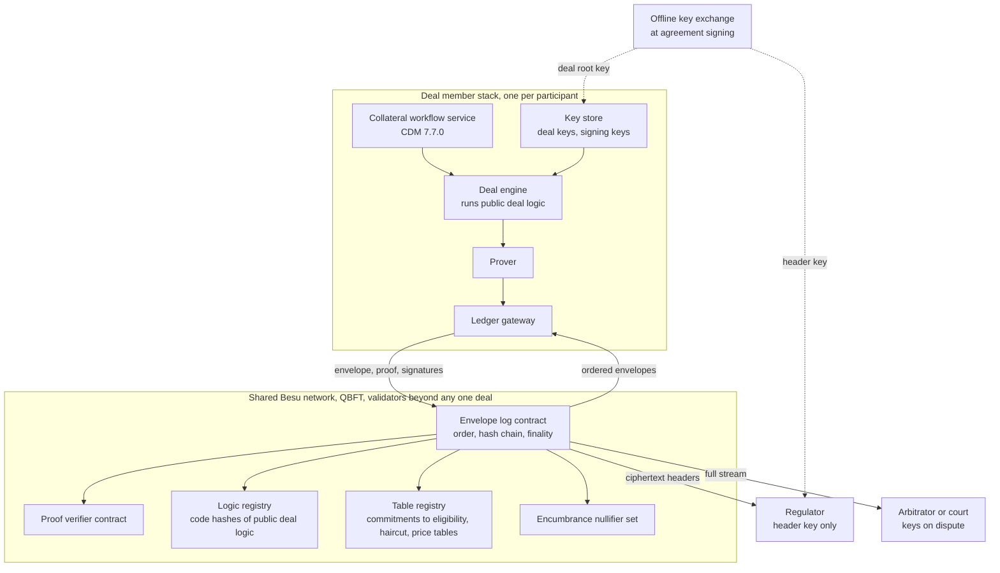
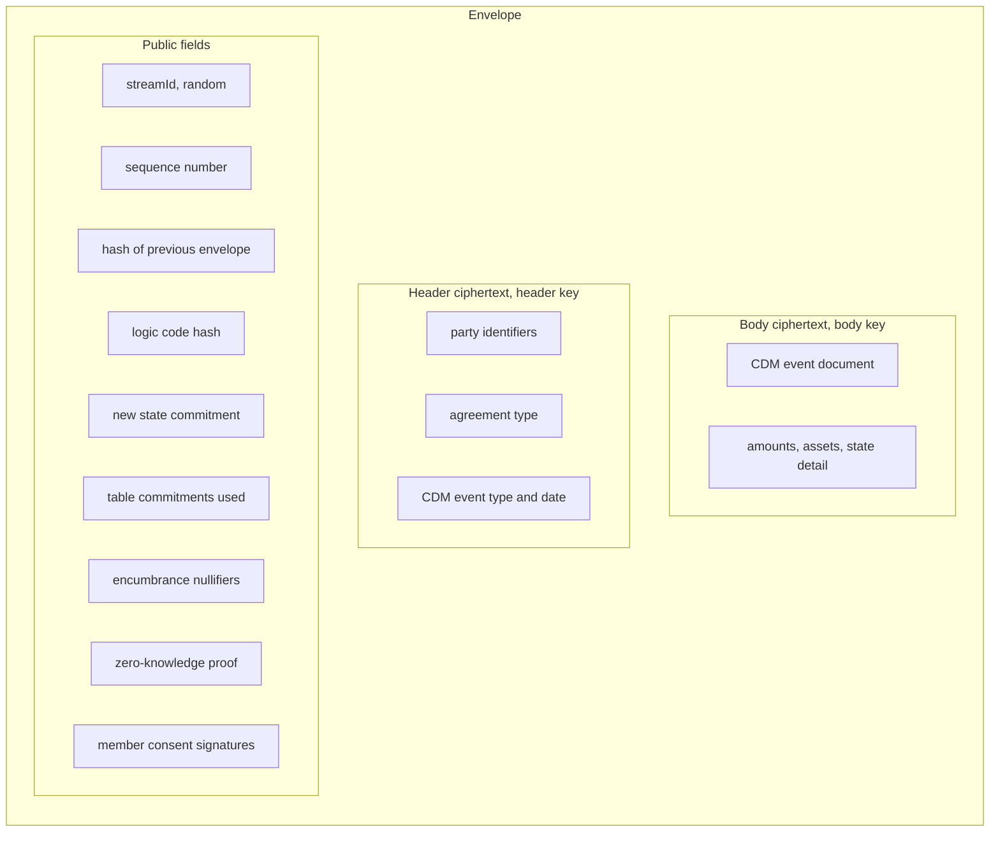
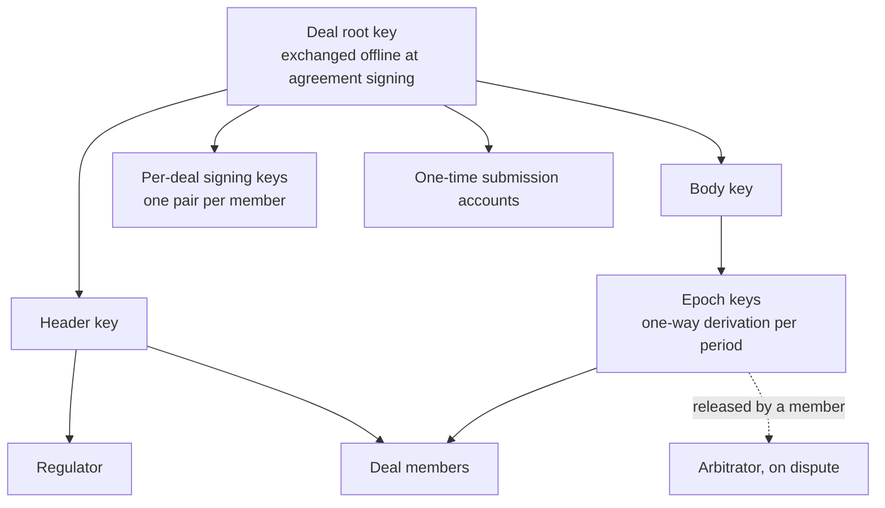
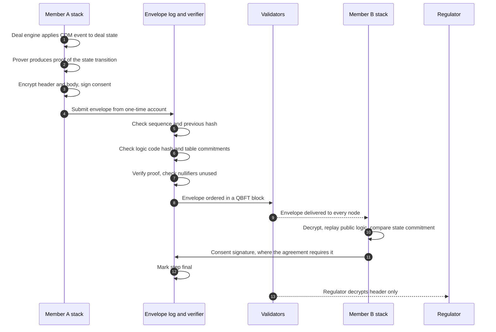
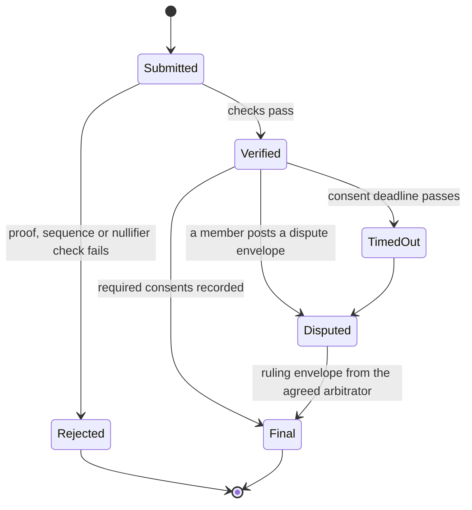
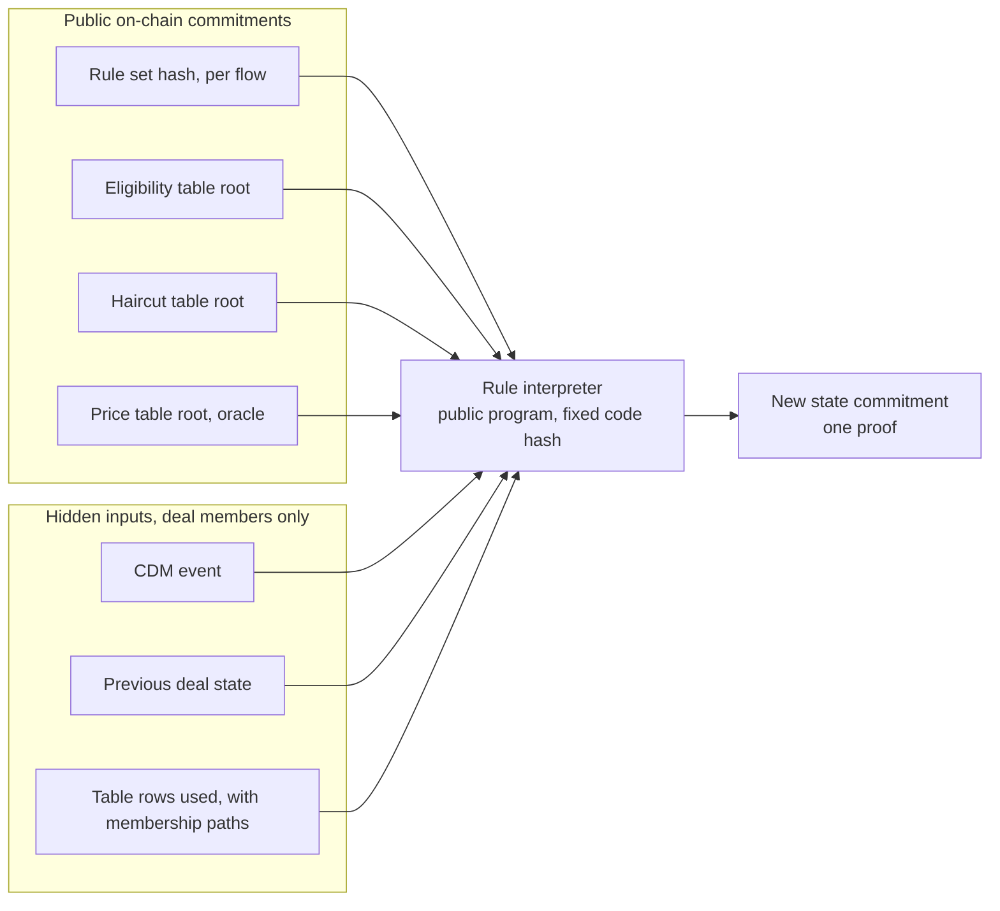
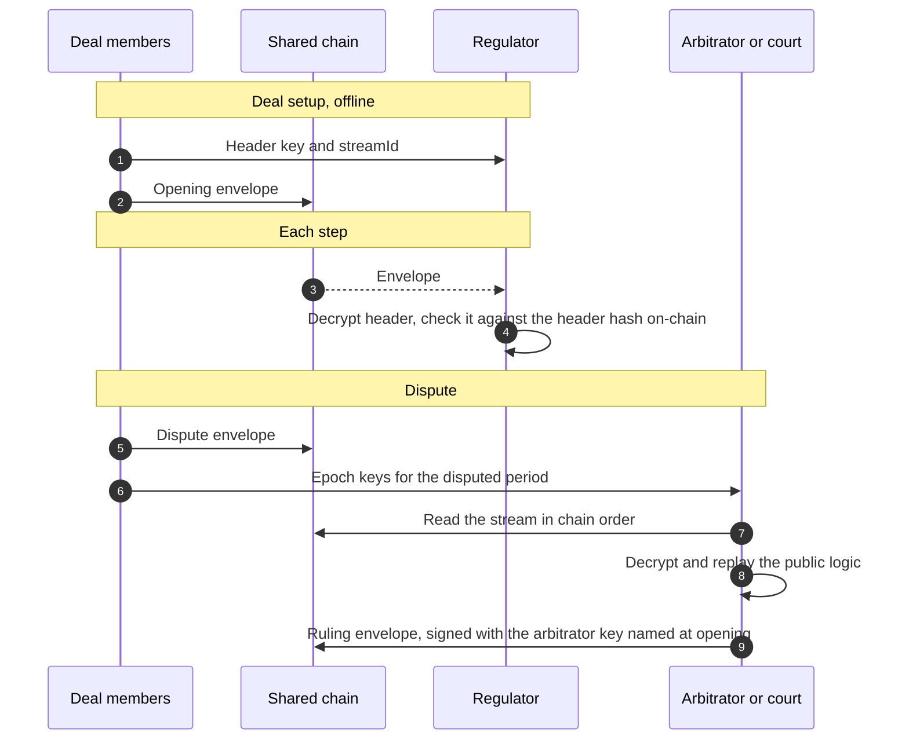
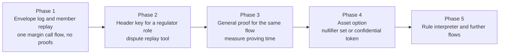

# On-chain privacy design: encrypted deal streams with verified state transitions

Output for `task-onchain-privacy` and `investigation-onchain-data-protection`. Recorded by
`artifact-onchain-privacy-design`.

| | |
|---|---|
| Status | Draft proposal, 2026-11-24 (UTC). Nothing in this document is implemented. |
| Decides | Nothing yet. Section 14 lists the decisions the project owner has to take. |
| Inputs | `nw-assumption-besu-visibility`, `nw-visibility-rule-deal-participants`, `nw-constraint-immutability-beyond-deal-parties`, option O9 in `investigation-onchain-data-protection`, `docs/analysis/bank-use-of-besu.md` |

**How to read the claims.** Each claim carries one of three labels where the label is not obvious from context:

- **Observed**: read from this repository on the branch `investigation/onchain-data-protection`.
- **Owner**: stated by the project owner in the investigation's source excerpts.
- **Proposed**: design content written by the maintainer. It has not been built, run or measured.

Statements about third-party software (Paladin, Canton, zero-knowledge virtual machines) come from documentation and
search results read on 2026-11-23 and 2026-11-24. None of that software was run for this document.

## 1. Problem

Every participant in the prototype runs its own QBFT validator node (`architecture/README.md`, Besu local network
row; Observed). Every participant therefore holds the full chain state. The contracts put counterparty addresses,
amounts and credit events on that chain in clear.

Leak inventory (Observed, `contracts/contracts/*.sol`, event signatures):

| Contract | What a non-party reads today |
|---|---|
| `MarginCall` | `CallIssued` (from, to, kind, amount), `CallAnswered` (agreed and disputed amounts), proposal and settlement steps |
| `CollateralControl` | `Pledged`, `Transferred` (parties, value), `Enforced`, `ClosedOut` (owed, applied), `InterestStated`, `SettlementNetted` (amounts), substitution and amendment steps |
| `CcpClearing` | `MarginStatementIssued` (member, vm, im), `MemberDefaulted` (defaulter, loss), `WaterfallApplied` (breakdown), `MemberJoined` (share), `PortingRequested` (from, to, payment) |
| `RepoSettlement` | `RepoBooked` (seller, buyer), `DefaultNoticeServed` (both parties), `CloseOutRecorded`, `CloseOutPaid` (amount) |
| `SecuritiesLoan` | `LoanBooked` (lender, borrower), `LoanReturnInstructed` (quantity, collateral amount), `LoanBilled` (amount), `LoanDefaultNoticeServed` |
| `TripartySettlement` | `TermsProposed` (giver, receiver, agent), `Deposited` (token, amount), `RepoRequested` (purchase price), `TradeEndPrepared` (repurchase price) |
| `PortfolioReconciliation` | `SnapshotCommitted` (party, counterparty), `ResultCommitted` (break count) |
| `OracleFeed` | `DefaultPublished(party, inDefault)`: a network-wide flag that a firm is in default. `PricePublished` is market data. |
| `ProvenanceAnchors`, `RecordKeeperRegister`, `TokenizedCollateral` | Asset-level records. Not assessed in this document (section 14, item 9). |

CDM document bodies are already off-chain in the payload store, readable by the call's two counterparties
(`architecture/README.md`, CDM payload store row; Observed). The exposure is the on-chain record.

## 2. Requirements

Context: collateral management flows between financial institutions (margin calls, pledges, substitutions, repo,
securities lending, triparty and CCP margin), where the counterparties are competitors, the positions and credit events
are commercially sensitive, and a deal's record has to stand as evidence in a dispute or a default.

### 2.1 Stated by the project owner

| # | Group | Requirement | Source |
|---|---|---|---|
| R1 | Authorized access | The direct participants in a deal see all of that deal's data. Every role the deal names (custodian, triparty agent, CCP, oracle, record keeper) counts as a participant for now. | `nw-visibility-rule-deal-participants` |
| R2 | Authorized access | An approved third party, for example a regulator, may see part of a deal's data, for example who the parties are. Marked possible. | Same record |
| R3 | Authorized access | Every other participant sees none of the deal's data. | Same record |
| R9 | Transparency of the data flow | Every network participant can see that a deal step was recorded: the envelope, its hashes and its position in the order. Seeing the flow gives no access to the data. | O9; `nw-requirements-onchain-privacy` |
| R4 | Immutability of data | A deal's record must not depend on the deal's own two or three parties alone. | `nw-constraint-immutability-beyond-deal-parties` |
| R10 | Immutability of evidence | The evidence for each step (order, time, proof, consents) is immutable in the same way as the data. | `nw-requirements-onchain-privacy` |
| R5 | Public logic | Deal logic is public and identified by its code hash. Terms and data are encrypted. | O9 |
| R6 | Keys | Keys are distributed to deal members offline. | O9 |
| R7 | Enforcement | Rules over hidden values are enforced on-chain by zero-knowledge proofs. | O9 |
| R8 | Scale | The prototype has 47 workflows (`docs/analysis/cdm-workflow-task-map.md`, `README.md`; Observed) and two tokenized test assets (`architecture/README.md`; Observed). The design must carry that number of flows, thousands of rules and asset types in the high hundreds. A circuit per rule or per asset type does not meet this. | O9; `nw-requirements-onchain-privacy` |

**R3 and R9 together.** A non-participant sees that some deal step happened and can check that it was recorded in
order. It sees no content and cannot identify the parties. This is the maintainer's reading of the two statements
and matches `nw-proposal-visibility-metadata-scope`; it needs the owner's confirmation (section 14, item 14).
Section 10 lists what the visible flow can still reveal by inference.

### 2.2 Proposed by the maintainer for the collateral context

These follow from the flows in the prototype and from `docs/analysis/bank-use-of-besu.md`. None is stated by the
owner. Each needs acceptance, change or removal.

| # | Requirement | Reason |
|---|---|---|
| R11 | **Single encumbrance.** The same asset lot cannot be pledged in two deals at once, and this is enforced without revealing the lot or the deals. | Collateral is only worth holding if it is not pledged elsewhere. |
| R12 | **Timeliness.** A step can be proved, recorded and consented within the deadline the agreement sets, including same-day margin call and intraday repo deadlines. | Proving time is the main unknown in section 8. |
| R13 | **Credit events stay inside the deal.** Disputes, default notices, close-out and enforcement are not distinguishable from routine steps by a non-participant. | A visible default signal about a firm can itself cause harm. |
| R14 | **Proof by one party.** A single member can prove a deal's content and history to an arbitrator, court or insolvency practitioner without the other member's cooperation. | Default and insolvency are the cases where the counterparty will not cooperate. |
| R15 | **Independence between deals.** An offline or uncooperative member blocks only steps of its own deals that need its consent. | A network-wide stall on one firm's outage is not acceptable in a margin process. |
| R16 | **Change of parties.** Novation, porting and CCP clearing can change a deal's members without exposing earlier data to a party not entitled to it. | These are existing flows (`CcpClearing`, `RepoSettlement`). |
| R17 | **Retention and erasure.** Records are kept for the regulatory retention period and can be made unreadable afterwards. | Drex was shut down partly over a data-protection conflict (press reports). |
| R18 | **Finality stated precisely.** The design states when a step is final on the ledger and does not present ledger finality as legal settlement finality. | BIS Agorá report, cited in `docs/analysis/bank-use-of-besu.md`. |
| R19 | **Link to the real asset.** The on-chain record of a pledge is tied to the asset's home ledger or custodian record. | A pledge record with no control over the asset has no value as collateral. |

### 2.3 Where the design addresses each requirement

| Requirement | Section |
|---|---|
| R1, R2, R3 | 5, 6, 10, 11 |
| R9 | 4, 5, 10 |
| R4, R10 | 4, 7, 11 |
| R5, R7, R8 | 7, 8 |
| R6 | 6 |
| R11, R19 | 9 |
| R12 | 8, 12, 13; not shown until proving time is measured |
| R13 | 5 (opaque state), 10 |
| R14 | 11 |
| R15 | 7 (deadlines, timed-out state) |
| R16 | 6 (member change) |
| R17 | 6 (epoch keys), 12; erasure is by key destruction only |
| R18 | 7 |

## 3. Options considered

Full table: `investigation-onchain-data-protection`, options O1 to O9.

| Option | Result against the requirements |
|---|---|
| Field minimization, pseudonyms, commitments, field encryption (O1 to O4) | Partial measures. Each is used inside this design; none meets R1 to R4 alone. |
| Paladin on Besu (O6) | Meets R1 and R4. Deal state is held only by members, group membership is fixed at creation, and a Noto notary sees all transfers of its token. Paladin had not shipped a version 1 (`docs/analysis/bank-use-of-besu.md`). |
| A Besu network per deal (O7) | Fails R4 with two or three validators. |
| Canton (O8) | Meets R1 to R3 closely. Fails R4 unless an independent synchronizer operator retains the message history. Drops R5 for non-participants. |
| Encrypted deal streams on the shared Besu chain (O9) | The design in this document. |

## 4. Design summary

Proposed. The shared Besu chain stops executing deal logic on clear data. It does three things:

1. **Orders and stores** encrypted envelopes, one per deal step, on every validator (R4).
2. **Verifies** a zero-knowledge proof with each envelope that the public deal logic, run on the hidden inputs,
   produced the new state commitment (R5, R7, R8).
3. **Records** each member's consent signature and marks the step final.

Deal members hold the keys, received offline (R6). They decrypt, replay the logic and check the result. A regulator
holds a key that opens only the header section of each envelope (R2).

Terms used below:

- **Deal stream**: the ordered sequence of envelopes for one deal, identified by a random stream identifier.
- **Envelope**: one on-chain record for one deal step.
- **State commitment**: a hash of the deal's full state after a step.
- **Deal engine**: the member-side component that runs the public deal logic.

## 5. Envelope

Proposed. Every validator stores every field. Only the fields marked public are readable without a key.

Rules for the fields:

- `streamId` is random and agreed offline. It is not derived from the parties.
- The state commitment and any lifecycle label are opaque hashes. A public label such as "in default" would leak a
  credit event (section 14, item 5).
- Envelopes are padded to fixed size classes to reduce what size reveals.
- The proof's public inputs bind it to this envelope: logic code hash, previous and new state commitments, table
  commitments, nullifiers and the hashes of both ciphertexts.

## 6. Keys

Proposed. R6 sets offline distribution. The rest is a starting point for section 14, item 6.

- **Header and body keys are separate.** The regulator receives the header key only (R2).
- **Epoch keys.** The body key is replaced each period by one-way derivation. Online systems hold the current epoch
  key. Earlier epoch keys are kept offline. A leaked current key then exposes one period.
- **Per-deal signing keys.** Consent signatures use key pairs created for the deal. The opening envelope commits to
  the set of public keys. The keys do not identify the institution to an outsider.
- **Member change.** A change of parties (novation, porting) closes the stream epoch and opens a new one with a new
  root key exchanged offline. The new member receives the state and the keys the agreement entitles it to.
- **Loss.** A member that loses its data recovers it from the chain with its keys. A member that loses its keys
  needs an escrow copy; who holds one is open (section 14, item 6).

## 7. Step lifecycle

Proposed.

What each check enforces:

| Check | Enforced by | Needs plaintext |
|---|---|---|
| Step order, no insertion or removal | Envelope log contract, hash chain | No |
| Logic identity | Logic registry, code hash | No |
| Every value rule in the deal logic | Proof verifier contract | No; the proof covers it |
| An asset lot is not encumbered twice | Nullifier set | No |
| Consent where the agreement requires agreement | Consent signatures | No |
| Response deadlines | Envelope log contract, block count | No |
| Correct result, second check | Each member's replay | Yes, member only |

A valid proof establishes that the step follows the rules. Consent signatures establish agreement where the agreement
calls for it, for example accepting a called amount. Block finality under QBFT is ledger finality; it is not legal
settlement finality (`docs/analysis/bank-use-of-besu.md`).

## 8. Rules and asset types at scale

R8 rules out one circuit per rule. Proposed:

- **One general proof per step.** A zero-knowledge virtual machine proves that a program ran correctly on hidden
  inputs. The program is the public deal logic. The number of rules does not change the number of proofs or
  verifier contracts. Proving cost follows the amount of code a step executes.
- **Rules as data.** The deal logic is a rule interpreter. Rule sets per flow are data, committed in the logic
  registry by hash. Adding a rule changes a committed rule set, not a circuit.
- **Asset types as data.** Eligibility schedules, haircut tables and prices are committed tables. The logic reads
  the rows it needs and the proof shows they belong to the committed table.

Constraints on this section:

- The zero-knowledge virtual machines found in search (RISC Zero, SP1) run programs compiled to RISC-V, with Rust as
  the documented language. The prototype's rule evaluation is CDM 7.7.0 Java (Observed). Java does not run in these
  machines directly (Proposed reading, unverified). The interpreter needs an implementation the prover can run,
  checked against the Java implementation by running both on the same inputs.
- A 2026 benchmarking paper reports that these machines trade larger proofs and higher memory for programmability,
  and that wrapping a proof to a small on-chain size has a high proving cost (section 15). No proving time has been
  measured for this design.
- On-chain verification of the wrapped proof uses elliptic-curve pairing operations. Besu support for the required
  precompiled contracts was not checked for this document.
- **Fallback tier.** Member replay enforces every rule without any proof. The design can start there and add the
  proof per flow (section 13).

## 9. Collateral assets

An ERC-20 transfer shows sender, receiver and amount. Encryption of the deal does not hide it or prevent the same
asset from being pledged twice. Two options; neither is selected (section 14, item 3).

| | A1: custodian-held assets with encumbrance records | A2: confidential tokens on-chain |
|---|---|---|
| Where the asset is | On its home ledger or with the custodian | A token on the shared chain with hidden owner and amount |
| What the deal records | An encumbrance on an asset lot, inside the envelope | A token transfer proved valid |
| Double-pledge prevention | A nullifier per encumbered lot in the on-chain nullifier set; a second encumbrance of the same lot repeats the nullifier and is rejected | The token's own spent-record mechanism |
| Who must be trusted | The custodian, for the link between lot and real asset | The token design and its proofs |
| Precedent | Encumbrance pattern attributed to the DTCC Collateral AppChain (single-source claim in `docs/analysis/bank-use-of-besu.md`) | Zeto on Besu (documentation, not exercised) |

Under A1 the custodian is a member of each deal it holds assets for (R1) and commits to its inventory of lots. The
proof shows that the nullifier derives from a lot in that committed inventory. This derivation is Proposed and needs
its own design before build.

## 10. Who sees what

Proposed. "Participant" means a deal member under R1.

| Data | Deal members | Regulator with header key | Other network participants | Validators as such |
|---|---|---|---|---|
| Parties to the deal | Yes | Yes | No | No |
| Agreement type, event type, date | Yes | Yes | No | No |
| Amounts, assets, CDM documents | Yes | No | No | No |
| Lifecycle state, including dispute and default | Yes | Event type only | No | No |
| That a stream exists, its step count and timing | Yes | Yes | **Yes** | **Yes** |
| Envelope size class | Yes | Yes | **Yes** | **Yes** |
| Which rule set and tables a step used | Yes | Yes | **Yes**, as hashes | **Yes**, as hashes |
| Submitting account | Yes | Yes | One-time account, see below | Same |

Residual exposure and measures:

- **Activity pattern.** Stream count, step count and timing are visible by requirement (R9). What they allow an
  observer to infer is the residual exposure, for example a burst of steps on one stream suggesting a dispute (R13). Measures for production: batching,
  randomized submission delay, padding (listed in SUERF Policy Note 420 for Paladin). The prototype measures the
  exposure and does not mitigate it (`nw-proposal-visibility-metadata-scope`).
- **Flow type.** A rule set hash per flow reveals which kind of flow a stream runs. One interpreter with the rule
  set as a hidden, committed input would hide it at more proving cost. Open (section 14, item 7).
- **Submitter.** One-time submission accounts avoid linking a stream to an institution. Besu account permissioning
  with an allow-list of known accounts would conflict with this. A relay service run by the market operator is the
  alternative. Open (section 14, item 8).
- **Oracle default status.** `DefaultPublished(party, inDefault)` cannot stay a network-wide event. The oracle posts
  a default envelope into each affected deal stream, as a member of those deals.
- **CCP data.** Each member's margin statement belongs in the stream of that member's deal with the CCP. Default
  fund shares belong in a stream whose members are the rulebook's members.

## 11. Regulator access and disputes

Proposed. Supersedes nothing: `nw-proposal-regulator-selective-disclosure` proposed disclosure packages for the
Paladin path; the header key is the equivalent for this design.

- Either member can prove a deal's content alone by releasing its keys. The chain fixes order and content, so the
  two members cannot present different histories (R4).
- The regulator cannot freeze or reverse a step in this design.
- Nothing on-chain forces members to give the regulator the header key at setup. Requiring a regulator
  acknowledgement signature on the opening envelope would enforce it and would require the regulator to be online at
  deal opening. Open (section 14, item 4).

## 12. Risks

| Risk | Effect | Measure |
|---|---|---|
| Body key leak | That period's deal data is readable by whoever holds the chain data, permanently | Epoch keys; earlier keys offline; hardware key storage |
| Ciphertext is permanent | Data cannot be erased, only made unreadable by destroying keys. Brazil's central bank cited a data-protection conflict when it shut Drex down (press reports, `docs/analysis/bank-use-of-besu.md`) | Keep personal data out of envelopes; legal review per jurisdiction |
| Flaw in the prover or the interpreter | An invalid step verifies. One flaw affects every rule | Member replay as a second check; independent review; differential tests against the CDM Java logic |
| Proving time too long for intraday flows | Steps miss deadlines | Measure on one flow first; fallback tier without proofs |
| Member offline | Steps needing its consent wait | Deadlines and the timed-out state |
| Key loss by a member | Member cannot read its own deals | Escrow copy; holder is open |
| Validator collusion | Reordering or censorship of envelopes. QBFT tolerates fewer than one third faulty validators | Validator set larger than any deal, with at least one validator that is party to no deal |
| The project owns the protocol | No vendor support and no outside review by default | Standard primitives only; commission a review before any production use |
| Zero-knowledge tooling maturity | Brazil's central bank judged zero-knowledge privacy designs immature for Drex | Fallback tier; proofs introduced per flow |

## 13. Prototype plan

Proposed. Each phase ends with something that runs on the local Besu network.

| Phase | Shows | Decision it informs |
|---|---|---|
| 1 | R1, R3, R4, R6, R9, R10; what an outsider can infer from the visible flow | Whether the residual exposure in section 10 is acceptable |
| 2 | R2; unilateral proof of content | Regulator model (item 4) |
| 3 | R5, R7 on one flow; proving time and the cost of a prover-compatible implementation | Whether R7 is practical for intraday flows |
| 4 | Collateral movement without a public transfer | Asset option (item 3) |
| 5 | R8 | Rule representation (item 2) |

Effect on the current contracts (Proposed):

| Current contract | In this design |
|---|---|
| `MarginCall`, `RepoSettlement`, `SecuritiesLoan`, `TripartySettlement`, `PortfolioReconciliation` | Logic moves into the public deal logic run by the deal engine. Events become envelopes. |
| `CollateralControl` | Escrow rules move into the deal logic. Asset movement follows the option chosen in section 9. |
| `CcpClearing` | One stream per member with the CCP, and one stream for the rulebook's members. |
| `OracleFeed` | `PricePublished` stays public as a committed price table. `DefaultPublished` becomes per-deal envelopes. |
| `TokenizedCollateral`, `ProvenanceAnchors`, `RecordKeeperRegister` | Not assessed (item 9). |

The accepted record `artifact-onchain-privacy-design` states that the prototype keeps full visibility because it uses
test data (`nw-prototype-scope`). This document proposes a design and a phased build. Whether the prototype builds
any phase is the owner's decision (item 1).

## 14. Open items

1. **Scope.** Does the prototype build phase 1, more phases, or record the design only (`nw-prototype-scope`)?
2. **Rule representation.** A rule interpreter with rules as committed data, or the deal logic reimplemented per
   flow in a prover-compatible language?
3. **Assets.** Custodian-held assets with encumbrance nullifiers (A1) or confidential tokens (A2)?
4. **Regulator.** Header key given offline by the members, or an on-chain acknowledgement by the regulator at deal
   opening? Which fields go in the header?
5. **State labels.** Confirm opaque state commitments with no public lifecycle label.
6. **Key model.** Epoch length, who holds an escrow copy, and the procedure when a deal's members change.
7. **Flow type visibility.** Accept that a rule set hash reveals the flow type, or hide the rule set at more proving
   cost?
8. **Submission.** One-time accounts or a relay service, given Besu account permissioning.
9. **Asset-level contracts.** Assess `TokenizedCollateral`, `ProvenanceAnchors` and `RecordKeeperRegister` once the
   asset option is chosen.
10. **Main path.** Does this design replace the tentative choice of Paladin (`nw-decision-onchain-privacy-paladin`)?
    Pente already provides off-chain execution with on-chain commitments and member signatures; a check of how much
    of this design it covers is outstanding.
11. **Tooling verification.** Which zero-knowledge virtual machines have verifier contracts that run on Besu, and
    their proving times for a margin call step.
12. **Validator set.** The number of validators and which institution runs the validator that is party to no deal.
13. **`nw-assumption-besu-visibility`.** Update it to cover all contracts in section 1, or supersede it.
14. **Requirements.** Confirm the reading of R3 with R9 in section 2.1, and accept, change or remove each of R11 to
    R19 in section 2.2.

## 15. Sources

Repository (Observed): `contracts/contracts/*.sol`; `architecture/README.md`; `docs/analysis/bank-use-of-besu.md`;
`.konspekt/instance/nodes/investigation/investigation-onchain-data-protection.md` and the noteworthies it notes.

External, read 2026-11-23 and 2026-11-24, not exercised:

- Hulek, Peresini, Homoliak, "A Unified Framework for Contract-Validated Benchmarking of Zero-Knowledge Proving
  Systems", IACR ePrint 2026/1729, https://eprint.iacr.org/2026/1729
- "Evaluating Compiler Optimization Impacts on zkVM Performance", arXiv 2508.17518,
  https://arxiv.org/abs/2508.17518 (RISC Zero and SP1 as RISC-V machines)
- Paladin documentation, https://lfdt-paladin.github.io/paladin/head/
- Canton documentation, https://docs.canton.network/overview/learn/privacy-model
- Besu documentation, private transaction processing (deprecated),
  https://besu.hyperledger.org/private-networks/concepts/privacy/private-transactions/processing
