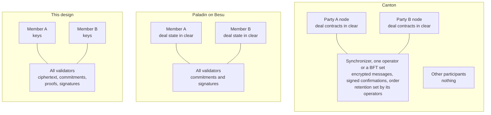
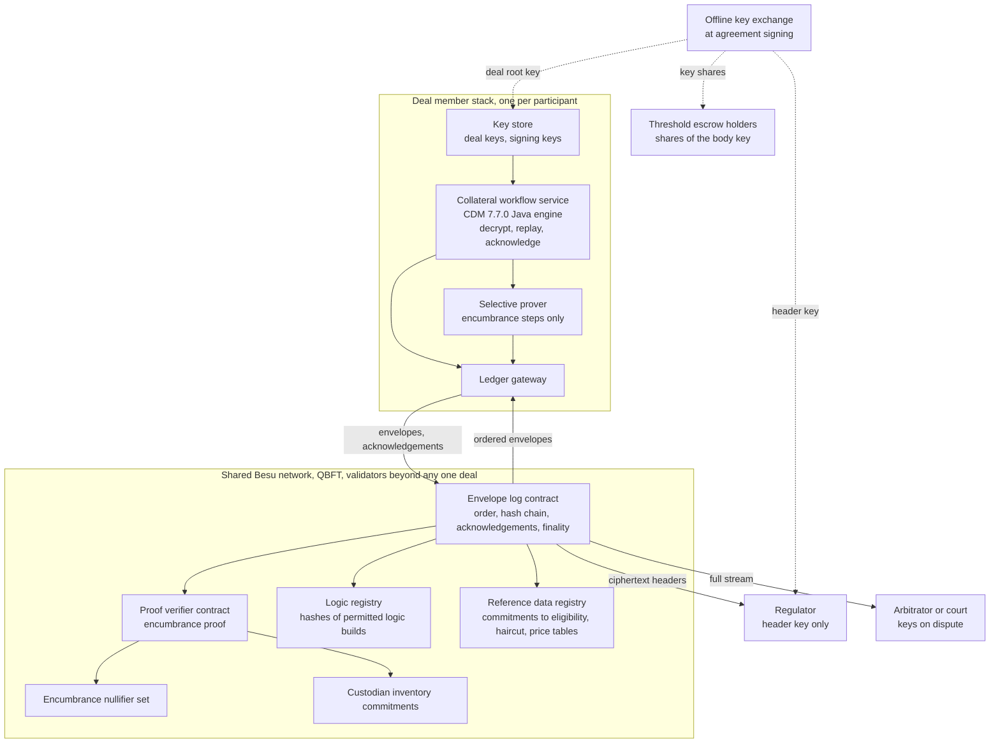
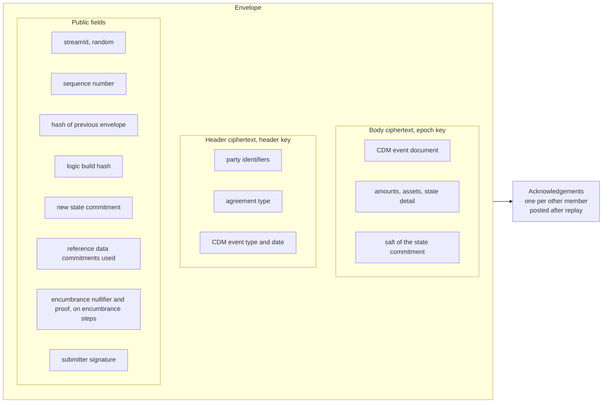
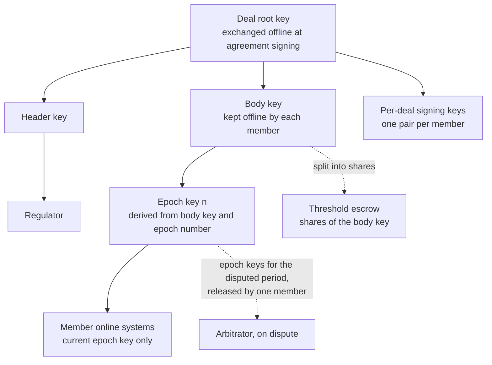
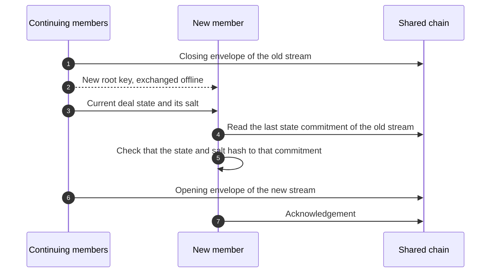
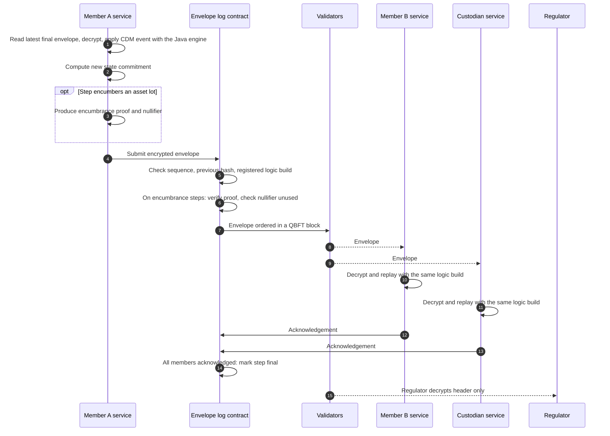
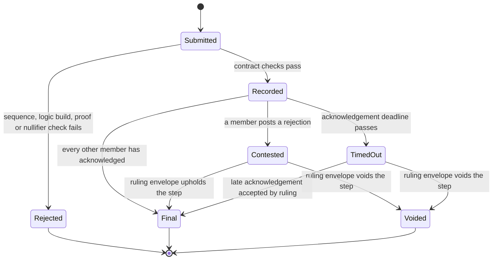
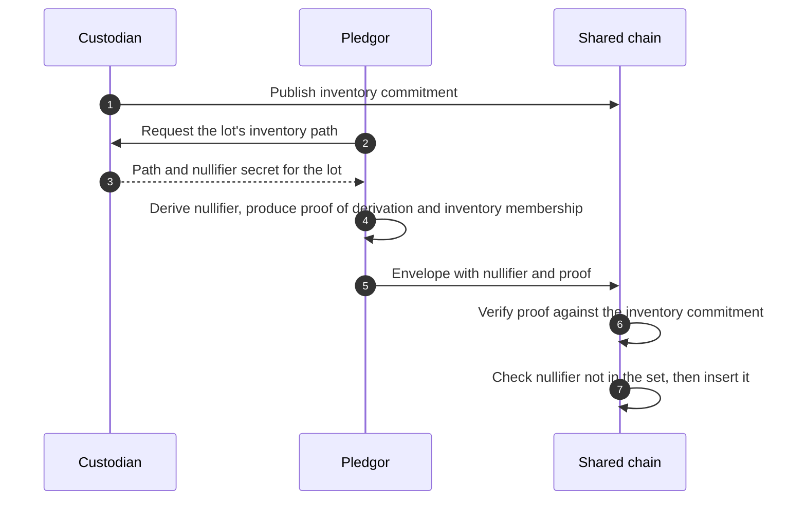
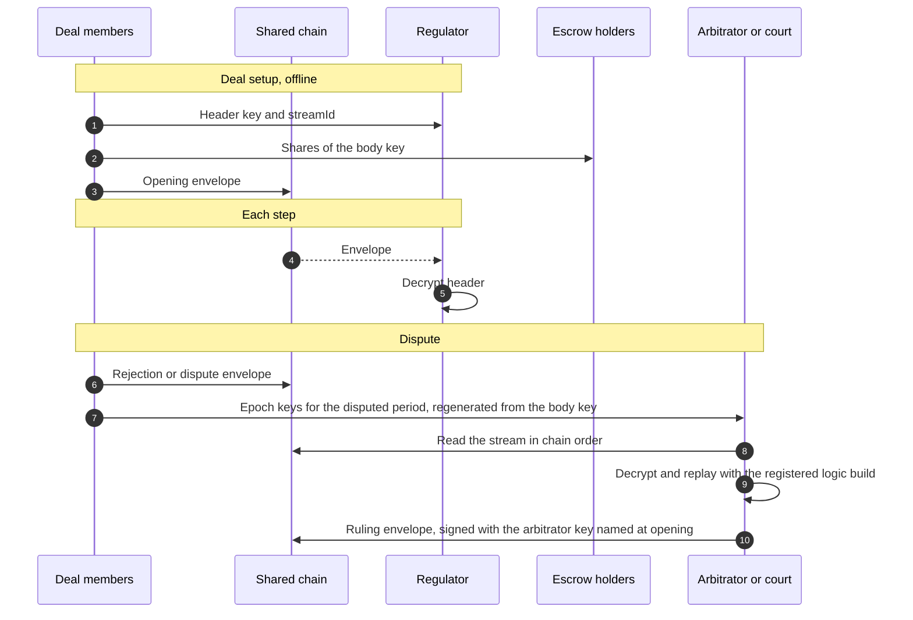
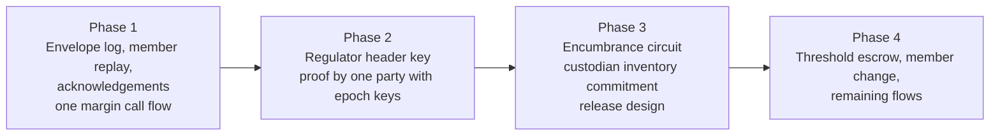

# On-chain privacy design: encrypted deal streams with shared-chain evidence and selective proofs

Output for the project task on on-chain privacy (konspekt id: `task-onchain-privacy`) and the investigation into protecting
on-chain data (konspekt id: `investigation-onchain-data-protection`). Recorded as a project document
(konspekt id: `artifact-onchain-privacy-design`).

An alternative version with Canton as the main path is in
[`onchain-privacy-canton.md`](onchain-privacy-canton.md). The project owner chose this document's design to try
(2026-11-23; konspekt id: `nw-decision-onchain-privacy-encrypted-streams`); the Canton version is kept as the alternative.

| | |
|---|---|
| Status | Revised draft, 2026-11-24 (UTC). Chosen by the owner as the design to try. Nothing in this document is implemented or measured. |
| Decides | Section 14 lists the decisions still open. |
| Inputs | The recorded assumption that every Besu node can read all contract state (konspekt id: `nw-assumption-besu-visibility`); the owner's visibility rule (konspekt id: `nw-visibility-rule-deal-participants`); the owner's constraint that a deal's record must not depend on its parties alone (konspekt id: `nw-constraint-immutability-beyond-deal-parties`); the design discussion recorded in the investigation (konspekt id: `investigation-onchain-data-protection`); `docs/analysis/bank-use-of-besu.md`, the owner-supplied design document versions 1.1 to 1.3 (section 15) |

**How to read the claims.** Each claim carries one of three labels where the label is not obvious from context:

- **Observed**: read from this repository on the branch `investigation/onchain-data-protection`.
- **Owner**: stated by the project owner in the investigation's source excerpts.
- **Proposed**: design content written by the maintainer. It has not been built, run or measured.

References to project records give a plain description followed by the record's konspekt id. The id locates the
record under `.konspekt/instance/` in the repository.

Sections 4 to 13 are design content. Where the owner set a point directly, the text says so.

Statements about third-party software (Paladin, Canton, proof systems) come from documentation and
search results read on 2026-11-23 and 2026-11-24. None of that software was run for this document.

## 1. Problem

Every participant in the prototype runs its own QBFT validator node (`architecture/README.md`, Besu local network
row; Observed). Every participant therefore holds the full chain state. The contracts put counterparty addresses,
amounts and credit events on that chain in clear.

Leak inventory (Observed, `contracts/contracts/*.sol`, event signatures):

| Contract | What a non-party reads today |
|---|---|
| `MarginCall` | `CallIssued` (from, to, kind, amount), `CallAnswered` (agreed and disputed amounts), proposal and settlement steps |
| `CollateralControl` | `Pledged`, `Transferred` (parties, value), `Enforced`, `ClosedOut` (owed, applied), `InterestStated`, `SettlementNetted` (amounts), substitution and amendment steps |
| `CcpClearing` | `MarginStatementIssued` (member, vm, im), `MemberDefaulted` (defaulter, loss), `WaterfallApplied` (breakdown), `MemberJoined` (share), `PortingRequested` (from, to, payment) |
| `RepoSettlement` | `RepoBooked` (seller, buyer), `DefaultNoticeServed` (both parties), `CloseOutRecorded`, `CloseOutPaid` (amount) |
| `SecuritiesLoan` | `LoanBooked` (lender, borrower), `LoanReturnInstructed` (quantity, collateral amount), `LoanBilled` (amount), `LoanDefaultNoticeServed` |
| `TripartySettlement` | `TermsProposed` (giver, receiver, agent), `Deposited` (token, amount), `RepoRequested` (purchase price), `TradeEndPrepared` (repurchase price) |
| `PortfolioReconciliation` | `SnapshotCommitted` (party, counterparty), `ResultCommitted` (break count) |
| `OracleFeed` | `DefaultPublished(party, inDefault)`: a network-wide flag that a firm is in default. `PricePublished` is market data. |
| `ProvenanceAnchors`, `RecordKeeperRegister`, `TokenizedCollateral` | Asset-level records. Not assessed in this document (section 14, item 9). |

CDM document bodies are already off-chain in the payload store, readable by the call's two counterparties
(`architecture/README.md`, CDM payload store row; Observed). The exposure is the on-chain record.

## 2. Requirements

Context: collateral management flows between financial institutions (margin calls, pledges, substitutions, repo,
securities lending, triparty and CCP margin), where the counterparties are competitors, the positions and credit events
are commercially sensitive, and a deal's record has to stand as evidence in a dispute or a default.

### 2.1 Stated by the project owner

| # | Group | Requirement | Source |
|---|---|---|---|
| R1 | Authorized access | The direct participants in a deal see all of that deal's data. Every role the deal names (custodian, triparty agent, CCP, oracle, record keeper) counts as a participant for now. | Owner's visibility rule (konspekt id: `nw-visibility-rule-deal-participants`) |
| R2 | Authorized access | An approved third party, for example a regulator, may see part of a deal's data, for example who the parties are. Marked possible. | Same rule |
| R3 | Authorized access | Every other participant sees none of the deal's data. | Same rule |
| R9 | Transparency of the data flow | Every network participant can see that a deal step was recorded: the envelope, its hashes and its position in the order. Seeing the flow gives no access to the data. | Owner's requirements statement (konspekt id: `nw-requirements-onchain-privacy`) |
| R4 | Immutability of data | A deal's record must not depend on the deal's own two or three parties alone. | Owner's immutability constraint (konspekt id: `nw-constraint-immutability-beyond-deal-parties`) |
| R10 | Immutability of evidence | The evidence for each step (order, time, proof, consents) is immutable in the same way as the data. | Owner's requirements statement (konspekt id: `nw-requirements-onchain-privacy`) |
| R5 | Public logic | Deal logic is public and identified by a hash. Terms and data are encrypted. In this design the hash identifies a build of the CDM workflow service (section 5). | Owner, design discussion |
| R6 | Keys | Keys are distributed to deal members offline. | Owner, design discussion |
| R7 | Enforcement | First stated as: rules over hidden values are enforced on-chain by zero-knowledge proofs. Relaxed by the owner's choice of this design: single encumbrance is enforced on-chain by a proof; every other rule is enforced by member replay with an explicit acknowledgement. | Owner's decision to try this design (konspekt id: `nw-decision-onchain-privacy-encrypted-streams`) |
| R8 | Scale | The prototype has 47 workflows (`docs/analysis/cdm-workflow-task-map.md`, `README.md`; Observed) and two tokenized test assets (`architecture/README.md`; Observed). The design must carry that number of flows, thousands of rules and asset types in the high hundreds. A circuit per rule or per asset type does not meet this. | Owner's requirements statement (konspekt id: `nw-requirements-onchain-privacy`) |

**R3 and R9 together.** A non-participant sees that some deal step happened and can check that it was recorded in
order. It sees no content and cannot identify the parties. This is the maintainer's reading of the two statements
and matches the earlier proposal on metadata visible to non-participants
(konspekt id: `nw-proposal-visibility-metadata-scope`); the owner's choice of this design accepts a visible flow.
Section 10 lists what the visible flow can still reveal by inference.

### 2.2 Proposed by the maintainer for the collateral context

These follow from the flows in the prototype and from `docs/analysis/bank-use-of-besu.md`. None is stated by the
owner. Each needs acceptance, change or removal.

| # | Requirement | Reason |
|---|---|---|
| R11 | **Single encumbrance.** The same asset lot cannot be pledged in two deals at once, and this is enforced without revealing the lot or the deals. | Collateral is only worth holding if it is not pledged elsewhere. |
| R12 | **Timeliness.** A step can be proved, recorded and consented within the deadline the agreement sets, including same-day margin call and intraday repo deadlines. | Proving time is the main unknown in section 8. |
| R13 | **Credit events stay inside the deal.** Disputes, default notices, close-out and enforcement are not distinguishable from routine steps by a non-participant. | A visible default signal about a firm can itself cause harm. |
| R14 | **Proof by one party.** A single member can prove a deal's content and history to an arbitrator, court or insolvency practitioner without the other member's cooperation. | Default and insolvency are the cases where the counterparty will not cooperate. |
| R15 | **Independence between deals.** An offline or uncooperative member blocks only steps of its own deals that need its consent. | A network-wide stall on one firm's outage is not acceptable in a margin process. |
| R16 | **Change of parties.** Novation, porting and CCP clearing can change a deal's members without exposing earlier data to a party not entitled to it. | These are existing flows (`CcpClearing`, `RepoSettlement`). |
| R17 | **Retention and erasure.** Records are kept for the regulatory retention period and can be made unreadable afterwards. | Drex was shut down partly over a data-protection conflict (press reports). |
| R18 | **Finality stated precisely.** The design states when a step is final on the ledger and does not present ledger finality as legal settlement finality. | BIS Agorá report, cited in `docs/analysis/bank-use-of-besu.md`. |
| R19 | **Link to the real asset.** The on-chain record of a pledge is tied to the asset's home ledger or custodian record. | A pledge record with no control over the asset has no value as collateral. |

### 2.3 Where the design addresses each requirement

| Requirement | Section |
|---|---|
| R1, R2, R3 | 5, 6, 10, 11 |
| R9 | 4, 5, 10 |
| R4, R10 | 4, 7, 11 |
| R5, R8 | 5, 7, 8 |
| R6 | 6 |
| R11, R19 | 9; covered for a first pledge of a whole lot only, until the asset lifecycle is designed |
| R12 | 7, 13; no general proof per step; acknowledgement and circuit times to be measured |
| R7 | 7, 9; as relaxed in section 2.1 |
| R13 | 5 (opaque state), 10; partly met |
| R14 | 11 |
| R15 | 7 (deadlines, timed-out state) |
| R16 | 6 (member change) |
| R17 | 6 (epoch keys), 12; erasure is by key destruction only |
| R18 | 7 |

## 3. Why existing solutions do not fully fit

No existing solution was run for this document. The assessments below rest on documentation, on
`docs/analysis/bank-use-of-besu.md` and on the project's own records. Each "does not meet" is a statement about the
requirements in section 2 as the owner set them. Several of these solutions meet a narrower set of requirements
better than this design does; section 3.7 states where.

### 3.1 Fit against the requirements

Legend: **Yes** meets it; **Part** meets it with a stated limit; **Conditional** meets it in a specific deployment
configuration (section 3.3); **No** does not meet it; **n/a** the solution takes a
different approach to the same concern.

| Requirement | Besu private transactions (Tessera) | Paladin: Pente with Noto or Zeto | Canton | Besu network per deal | Field measures on today's contracts | This design |
|---|---|---|---|---|---|---|
| R1 members see all | Yes | Yes | Yes | Yes | Yes | Yes |
| R2 regulator sees part | No | Part | Yes | No | Part | Yes |
| R3 others see no data | Yes | Yes | Yes | Yes | No | Yes |
| R9 the flow is visible to all | Part | Yes | **No** | No | Yes | Yes |
| R4 record held beyond the deal's parties | Part | Part | **Conditional** | **No** | Yes | Yes |
| R10 evidence held beyond the deal's parties | Part | Yes | Conditional | No | Yes | Yes |
| R5 public logic | No | No | No | Part | Yes | Yes |
| R6 keys distributed offline | n/a | n/a | n/a | n/a | Part | Yes |
| R7 rules over hidden values enforced on-chain | No | Part | No | n/a | No | Part: single encumbrance only |
| R8 scale of flows, rules, asset types | Yes | Yes | Yes | Part | Yes | Target: rules stay in the CDM engine |
| R11 single encumbrance, hidden | No | Part | Yes | No | No | Target: lifecycle incomplete |
| Status | Deprecated | Pre-version 1 | In production use elsewhere | Buildable today | Buildable today | Not built |

### 3.2 Where each solution keeps the deal record

R4 and R10 depend on which nodes hold a deal's record. The three candidates differ on exactly this point.

### 3.3 Canton

What it does well: Canton sends each part of a transaction only to the parties entitled to it, and a participant
that is not involved does not learn that the transaction happened (Canton documentation). Regulator access is
declared in the contract. It is the closest fit to R1, R2 and R3, and it is used in production for related use cases.

Why it does not fully fit:

- **The record beyond the deal's parties depends on how the synchronizer is run (R4, R10).** Canton has no chain that
  every participant copies. A two-party deal's contracts are stored in clear on the two parties' own nodes only. The
  synchronizer holds the rest of the record. Read from Canton documentation on 2026-11-24:
  - each confirming participant sends a cryptographically signed approval or rejection through the sequencer, so the
    signed confirmations are part of the sequenced history;
  - the Daml architecture FAQ states that ledger data lives on the participant nodes and on the sequencer backend,
    and a participant can replay missing data from the synchronizer;
  - the sequencer can run as a Byzantine fault tolerant set across several operators (the Global Synchronizer runs
    this way);
  - pruning is a schedule each operator sets; it is not mandatory.

  A Canton deployment whose synchronizer is run by several operators independent of the deals, with history retained
  for the required period, therefore holds an ordered, signed, encrypted record outside the deal's parties. On the
  documentation that configuration meets R4 and R10. A single-operator synchronizer, or one that prunes early, does
  not. The owner's objection that a two-node record returns to one party's word against the other's
  (konspekt id: `nw-constraint-immutability-beyond-deal-parties`) applies to the parties' own stores and to those weaker
  configurations. It does not hold against the retained, multi-operator configuration.

  Not verified by test: that one party, with its own keys and the retained sequencer history, can prove a deal's
  content and order to a third party (R14); and how participant key rotation affects that.
- **No visible flow (R9).** Hiding the existence of a transaction from non-participants is a design goal of Canton. It
  is the opposite of transparency of the data flow.
- **Logic is not public to the network (R5).** Each participant installs the Daml package on its own node. A
  non-participant cannot see or check which logic a deal ran.
- **Enforcement is by the deal's parties (R7).** The parties' nodes validate each step. No node outside the deal
  checks a rule. This design, with R7 relaxed, has the same property for every rule
  except single encumbrance.
- **Different stack.** The prototype's logic is Solidity on Besu with CDM in Java. Canton needs the deal logic
  written in Daml. Canton stays the planned second ledger under the project's
  architecture decision on prototype ledgers (konspekt id: `wp-adr-prototype-ledgers`).
- **Single maintainer.** The open-source edition is Apache 2.0 and Digital Asset maintains it. Which enterprise
  features are in the open-source edition today was not verified.

### 3.4 Paladin (Pente privacy groups with Noto or Zeto tokens)

What it does well: it runs on unmodified Besu. Pente executes deal logic privately among a group's members and
records commitments and member signatures on the shared chain, which covers R1, R3, R9 and R10. Zeto provides
confidential tokens with zero-knowledge proofs. It is the nearest existing design to this one.

Why it does not fully fit:

- **Pente cannot run the deal logic.** Pente executes Solidity contracts in a private EVM. The deal logic in this
  design is the CDM Java engine. Using Pente would mean rewriting the rules in Solidity.
- **Deal data is held only by the members (R4).** Validators hold commitments. If the members lose or alter their
  copies, the commitment shows a mismatch and cannot restore the content. SUERF Policy Note 420 names off-chain state
  management as the main open issue.
- **Logic is private to the group (R5).** The contract is deployed inside the privacy group. Non-members cannot see
  or check it.
- **Rules are enforced by member endorsement (R7).** Validators verify signatures and state transitions between
  commitments. They do not verify that a value rule held. Zeto's proofs cover token transfers with fixed circuits and
  do not cover deal rules. This design, with R7 relaxed, enforces deal rules the same way.
- **Regulator sees all or nothing (R2).** A group member sees all of the group's data and has to endorse. A partial
  view needs application code (proposal for regulator selective disclosure,
  konspekt id: `nw-proposal-regulator-selective-disclosure`).
- **Membership is fixed at group creation.** A change of parties needs a new group and a state migration (R16).
- **Noto's notary sees every transfer of its token**, across deals it is not part of.
- **Maturity.** The LF Decentralized Trust 2026 annual review lists releases 0.14 to 0.16 and work toward a version 1
  in 2026. No version 1 release was found in a search on 2026-11-24; the release list itself was not checked. All
  listed maintainers are from one company.

### 3.5 Besu private transactions (Tessera)

Besu's own private transactions sent payloads between selected nodes through Tessera and recorded a marker on the
shared chain. The Besu maintainers announced the end of Tessera support in September 2024 and the Besu documentation
marks the feature deprecated. The project task on on-chain privacy (konspekt id: `task-onchain-privacy`) records that the Besu version in use has no private
transactions. A deprecated component cannot carry a new design.

### 3.6 A Besu network per deal, and field measures on the current contracts

- **Network per deal or per relationship.** Meets R1 and R3 by separation. Its validators are the deal's two or three
  parties, so it fails R4 and R10, and nobody outside sees the flow
  (R9). Assets moving between networks need a bridge. Brazil's central bank judged separate networks to add
  complexity and interoperability risk (Drex phase 1 report).
- **Field measures:** dropping or hashing fields, per-agreement addresses, commitments with off-chain
  reveal, field encryption. They keep R4, R5, R9 and R10 because everything stays on the shared chain. They do not
  meet R3: token transfers, funding flows and the public default flag still expose amounts or relink parties. This
  design uses all four as components.
- **Privacy add-ons tested in Drex** (Anonymous Zether, Starlight, Rayls). Brazil's central bank reported that none
  met its needs; a recurring reason was that the authority could not see or act on hidden transactions (R2). They
  were not assessed further here.

### 3.7 What this design gives up in exchange

- **Canton can meet R4.** With a retained, multi-operator synchronizer (section 3.3), the case for this design over
  Canton does not rest on immutability. It rests on a flow visible to all participants (R9), history held by every
  validator, and continued use of the existing Besu network and CDM Java service. The owner chose this design on
  that basis.
- **Canton hides more.** Under Canton a non-participant does not learn that a deal step happened. Under this design
  it does, by requirement (R9), and can draw inferences from timing and volume (section 10).
- **Paladin and Canton exist.** Both have running code, documentation and users. This design has none and the
  project would own the protocol (section 12).
- **Rules are enforced by the deal's members, as in Paladin and Canton.** Only single encumbrance is enforced
  on-chain by a proof (section 9).
- **Canton prevents double pledging without a circuit.** This design needs a custom circuit, a nullifier set and an
  asset lifecycle that is not yet designed.
- **A new key scheme.** Canton and Paladin handle key distribution themselves. This design needs the scheme in
  section 6 and the operations around it.

## 4. Design summary

The shared Besu chain stops executing deal logic on clear data. It does three things:

1. **Orders and stores** one encrypted envelope per deal step on every validator (R4, R9, R10).
2. **Records acknowledgements.** Every other member replays the step and posts an explicit acknowledgement. A step is
   final only when every member has acknowledged it. Silence never counts as acceptance (Owner).
3. **Verifies one small proof** on steps that encumber an asset lot, and rejects a lot that is already encumbered
   (R11).

Deal members hold the keys, received offline (R6). Each member runs the existing CDM Java engine in its own workflow
service: it reads envelopes from the chain, decrypts, replays and acknowledges. That is the whole private execution
model. No private virtual machine is used. A regulator holds a key that opens only the header section of each
envelope (R2).

Terms used below:

- **Deal stream**: the ordered sequence of envelopes for one deal, identified by a random stream identifier.
- **Envelope**: one on-chain record for one deal step.
- **State commitment**: a salted hash of the deal's full state after a step.
- **Acknowledgement**: a member's signature stating that its own replay of the step produced the same state
  commitment.
- **Logic build**: one released build of the collateral workflow service with its CDM version, identified by a hash.

### 4.1 What is not built

- **A general proof of the rule engine for every step.** Earlier drafts proposed it. It needed a second
  implementation of the CDM rules in a prover-compatible language and its proving time was unmeasured against
  intraday deadlines. The owner chose the selective design.
- **A private virtual machine.** Paladin's Pente runs Solidity contracts. The deal logic here is the CDM Java engine,
  which Pente cannot run.
- **Besu private transactions.** Deprecated (section 3.5).

## 5. Envelope

Every validator stores every field. Only the fields marked public are readable without a key.

Rules for the fields:

- `streamId` is random and agreed offline. It is not derived from the parties.
- The state commitment is an opaque salted hash. No lifecycle label is public.
- **The logic build hash is a declaration by the submitter.** The contract checks that the hash is in the logic
  registry. It cannot check that the submitter ran that build. The other members' replay with the same build is what
  enforces it.
- **One build hash covers all flows.** It identifies the service build, not a rule set per flow, so it does not
  reveal which kind of flow a stream runs.
- Envelopes are padded to fixed size classes.

## 6. Keys

R6 sets offline distribution. The derivation below is Proposed and needs confirmation (section 14, item 3).

- **Header and body keys are separate.** The regulator receives the header key only (R2).
- **Epoch keys derive from the body key and the epoch number.** Each member keeps the body key offline and loads only
  the current epoch key into its online systems. A leaked epoch key exposes one period. Any earlier epoch key can be
  regenerated from the body key, so prior epoch keys need not be stored.
- **Proof by one party (R14).** A member regenerates the epoch keys for the disputed period from its body key and
  gives them to the arbitrator. The current epoch key alone does not open earlier periods.
- **Escrow is threshold-based.** The body key is split into shares held by several holders. No single holder,
  including a regulator, can read deal bodies. Release follows a pre-agreed policy, for example insolvency or a court
  order. The holders and the threshold are open (section 14, item 4).
- **Per-deal signing keys.** Submitter signatures and acknowledgements use key pairs created for the deal. The
  opening envelope commits to the set of public keys. The keys do not identify the institution to an outsider.
- **Member change (R16).** Novation or porting closes the stream and opens a new one with a new root key exchanged
  offline. The continuing members give the new member the current state and its salt. The new member checks that
  they hash to the last state commitment on-chain. It receives no earlier keys, so earlier envelopes stay unreadable
  to it.
- **Loss.** A member that loses its data recovers it from the chain with its keys. A member that loses its body key
  recovers it from escrow.

Member change, step by step:

## 7. Step lifecycle

Rules:

- **Explicit acknowledgement on every step (Owner).** Every member other than the submitter posts an acknowledgement
  for every envelope. An acknowledgement states one thing: "my replay of this envelope produced this state
  commitment". Silence is never acceptance.
- **Acknowledgement is not business consent.** Agreeing to a called amount, accepting a substitution or answering a
  dispute are steps of the deal logic. Each is its own envelope, submitted by the consenting member, and
  acknowledged by the others.
- **A rejection** is a signed statement that the member's replay produced a different result. It moves the step to
  Contested and to the dispute path (section 11).
- **One step at a time per stream.** The contract accepts the next sequence number only after the previous step is
  Final or Voided. If two members submit the same sequence number, the first ordered is accepted and the other is
  rejected and retried.
- **Deadlines.** The acknowledgement deadline is a number of blocks set in the opening envelope. An unresponsive
  member stalls only the streams it belongs to (R15).

What enforces what:

| Check | Enforced by | Needs plaintext |
|---|---|---|
| Step order, no insertion or removal | Envelope log contract, hash chain | No |
| Logic build is a permitted one | Logic registry | No |
| An asset lot is not encumbered twice | Encumbrance proof, nullifier set | No |
| Every CDM rule | Each member's replay, shown by its acknowledgement | Yes, members only |
| Business consent | The consenting member's own envelope | Yes, members only |
| Response deadlines | Envelope log contract, block count | No |

No node outside the deal checks a CDM rule. All of a deal's members acting together, including the custodian, could
record a step that breaks a rule. Canton and Paladin have the same property. Block finality under QBFT is ledger
finality; it is not legal settlement finality (`docs/analysis/bank-use-of-besu.md`).

## 8. Rules, flows and asset types at scale

- **The rules stay where they are.** The 47 workflows and the CDM rules run in the existing Java workflow service
  (Observed). No second implementation is written. Adding a rule or an asset type is a change to the service or its
  reference data.
- **Deterministic replay is a requirement on the service.** Every member has to compute the same state commitment
  from the same envelope. That needs: the same logic build; the same reference data, pinned by the commitments in
  the envelope; no dependence on local time, locale, random values or map ordering; decimal arithmetic with fixed
  rules. Whether the current service meets this was not checked (section 14, item 5).
- **Upgrades are coordinated.** The logic registry lists the permitted builds and the block from which each applies.
  Every member of a stream must run a permitted build. The upgrade procedure belongs in the network rulebook.
- **Reference data.** Eligibility schedules, haircut tables and prices are committed in the reference data registry.
  An envelope names the commitments it used, so every member replays against the same data.

## 9. Collateral assets

Option A1 is the design: the asset stays on its home ledger or with the custodian, and the deal records an
encumbrance. Confidential tokens (A2, for example Zeto) are deferred.

- The custodian is a member of every deal that encumbers its lots (R1) and publishes a commitment to its inventory
  of lots.
- **The proof shows one thing:** the nullifier is correctly derived from a lot that is in the custodian's committed
  inventory. The circuit is fixed and independent of the CDM flow.
- **The contract, not the circuit, checks that the nullifier is unused.** A second encumbrance of the same lot
  repeats the nullifier and is rejected.
- The link between a lot and the real asset rests on the custodian (R19).

**Not yet designed.** Until these exist, R11 is covered only for the first pledge of a whole lot against a fixed
inventory commitment:

| Gap | Sketch (Proposed, not designed) |
|---|---|
| Release on return or substitution | The custodian retires the lot and issues a new lot identifier for the same asset, which yields a new nullifier |
| Partial encumbrance | The custodian splits the lot into two lots before the pledge |
| Inventory that changes with every custodian movement | Inventory commitments per period, with the contract accepting proofs against a recent commitment |
| Who derives the nullifier | Shown above as the pledgor with a secret from the custodian; the custodian deriving it is the alternative |

## 10. Who sees what

"Participant" means a deal member under R1.

| Data | Deal members | Regulator with header key | Other network participants | Validators as such |
|---|---|---|---|---|
| Parties to the deal | Yes | Yes | No | No |
| Agreement type, event type, date | Yes | Yes | No | No |
| Amounts, assets, CDM documents | Yes | No | No | No |
| Lifecycle state | Yes | Event type only | No | No |
| That a stream exists, its step count and timing | Yes | Yes | **Yes** | **Yes** |
| Number of members, from the acknowledgement count | Yes | Yes | **Yes** | **Yes** |
| Which steps encumber an asset | Yes | Yes | **Yes** | **Yes** |
| That a step was contested, timed out or ruled on | Yes | Yes | **Yes** | **Yes** |
| Envelope size class | Yes | Yes | **Yes** | **Yes** |
| Kind of flow | Yes | Yes | No | No |
| Submitting account | Yes | Yes | See below | See below |

Residual exposure:

- **Activity pattern.** Stream count, step count and timing are visible by requirement (R9). A burst of steps on one
  stream can suggest a dispute.
- **Credit-relevant steps are distinguishable (R13 is partly met).** A nullifier and proof appear only on
  encumbrance steps. Rejections, timeouts and ruling envelopes are visible as such. Measures that would hide them
  (a dummy proof on every step, acknowledgement-shaped rejections) add cost and are not in the baseline. Accepting
  this is the owner's decision (section 14, item 2).
- **Submitter.** One-time submission accounts avoid linking a stream to an institution. Besu account permissioning
  with an allow-list of known accounts conflicts with that; a relay run by the market operator is the alternative.
  Open (section 14, item 6).
- **Oracle default status.** `DefaultPublished(party, inDefault)` cannot stay a network-wide event. The oracle posts
  a default envelope into each affected deal stream, as a member of those deals.
- **CCP data.** Each member's margin statement belongs in the stream of that member's deal with the CCP. Default
  fund shares belong in a stream whose members are the rulebook's members.
- Measures available for production: batching, randomized submission delay, padding. Phase 1 measures the exposure
  before any of them is chosen.

## 11. Regulator access and disputes

- One member can prove a deal's content alone. The chain fixes order and content, so two members cannot present
  different histories (R4, R14). A member that has lost its body key obtains it from escrow.
- The regulator never receives body keys and cannot freeze or reverse a step.
- Nothing on-chain forces members to give the regulator the header key. Requiring a regulator acknowledgement on
  the opening envelope would enforce it and would require the regulator to be online at deal opening. Open
  (section 14, item 7).

## 12. Risks

| Risk | Effect | Measure |
|---|---|---|
| No rule check outside the deal | All members of a deal together can record an invalid step | Custodian as a member of asset steps; same property as Canton and Paladin |
| Replay is not deterministic | Honest members compute different commitments; steps are contested for no reason | Determinism requirements in section 8; replay tests across builds |
| Uncoordinated upgrade | Members on different builds cannot acknowledge each other | Logic registry with activation blocks; rulebook procedure |
| Member offline | Its streams stall until the deadline, then go to a ruling | Deadlines; operational standards for members |
| Body key leak | That deal's history is readable by whoever holds the chain data, permanently | Body key offline; hardware key storage; epoch keys online |
| Ciphertext is permanent | Data cannot be erased, only made unreadable by destroying keys. Brazil's central bank cited a data-protection conflict when it shut Drex down (press reports) | Keep personal data out of envelopes; legal review per jurisdiction (R17) |
| Flaw in the encumbrance circuit | A lot could be encumbered twice, or a valid pledge refused | Small fixed circuit; independent review |
| Custodian misstates its inventory | Encumbrances of assets that do not exist | Inherent to A1; custodian controls and audit |
| Validator collusion | Reordering or censorship. QBFT tolerates fewer than one third faulty validators | Validator set larger than any deal, with at least one validator that is party to no deal |
| The project owns the protocol | No vendor support and no outside review by default | Standard primitives; commission a review before production use |
| Acknowledgement volume | One transaction per member per step | Measure in phase 1 |

## 13. Prototype plan

Each phase ends with something that runs on the local Besu network. No requirement is claimed as met until its phase
has run.

| Phase | Shows | Informs |
|---|---|---|
| 1 | R1, R3, R4, R6, R9, R10, R15; deterministic replay on one flow | What an outsider can infer; acknowledgement cost |
| 2 | R2, R14 | Regulator model; key derivation |
| 3 | R11 for a first pledge; proving time of the circuit | Asset lifecycle design |
| 4 | R16, R8 across the flows | Readiness for a wider trial |

Effect on the current contracts:

| Current contract | In this design |
|---|---|
| `MarginCall`, `RepoSettlement`, `SecuritiesLoan`, `TripartySettlement`, `PortfolioReconciliation` | State machines move into the workflow service's replay logic. Events become envelopes. |
| `CollateralControl` | Escrow rules move into the replay logic. Asset movement becomes an encumbrance under section 9. |
| `CcpClearing` | One stream per member with the CCP, and one stream for the rulebook's members. |
| `OracleFeed` | `PricePublished` stays public as committed reference data. `DefaultPublished` becomes per-deal envelopes. |
| `TokenizedCollateral`, `ProvenanceAnchors`, `RecordKeeperRegister` | Not assessed (section 14, item 9). |

The project's accepted record for this document (konspekt id: `artifact-onchain-privacy-design`) states that the prototype
keeps full visibility because it uses test data only (konspekt id: `nw-prototype-scope`). The owner has since chosen this design to try. How many phases the prototype builds
is open (section 14, item 1).

## 14. Open items

1. **Scope.** Which phases does the prototype build? The recorded prototype scope uses test data only
   (konspekt id: `nw-prototype-scope`).
2. **Distinguishable steps.** Accept that encumbrance, rejection, timeout and ruling steps are visible as such, or
   pay for measures that hide them.
3. **Key derivation.** Confirm epoch keys derived from an offline body key, and set the epoch length.
4. **Escrow.** Holders, threshold and release policy.
5. **Deterministic replay.** Check the current workflow service against the requirements in section 8.
6. **Submission.** One-time accounts or a relay, given Besu account permissioning.
7. **Regulator.** Header key given offline, or an on-chain acknowledgement at deal opening; the header fields.
8. **Asset lifecycle.** Release, partial lots, changing inventory, and who derives the nullifier (section 9).
9. **Asset-level contracts.** Assess `TokenizedCollateral`, `ProvenanceAnchors` and `RecordKeeperRegister`.
10. **Acknowledgement deadline** per flow, and the arbitrator named at opening.
11. **Validator set.** The number of validators and which institution runs the validator that is party to no deal.
12. **Visibility assumption** (konspekt id: `nw-assumption-besu-visibility`). Update it to cover all contracts in section 1, or supersede it.
13. **Requirements.** Accept, change or remove each of R11 to R19 in section 2.2.
14. **Canton evidence test.** The Canton version's premise (proof by one party from sequencer history) is untested.
    Run it only if the owner wants the comparison kept open.

## 15. Sources

Repository (Observed): `contracts/contracts/*.sol`; `architecture/README.md`; `docs/analysis/bank-use-of-besu.md`;
`.konspekt/instance/nodes/investigation/investigation-onchain-data-protection.md` and the noteworthies it notes.

Owner-supplied: "On-Chain Privacy Design: Encrypted Deal Streams with Shared-Chain Evidence and Selective Proofs",
versions 1.1 to 1.3, 24 November 2026. This document adopts version 1.3's decisions (no private virtual machine,
member replay, selective proof for encumbrance only, threshold escrow) and adds the acknowledgement rule the owner
set afterwards.

External, read 2026-11-23 and 2026-11-24, not exercised:

- Hulek, Peresini, Homoliak, "A Unified Framework for Contract-Validated Benchmarking of Zero-Knowledge Proving
  Systems", IACR ePrint 2026/1729, https://eprint.iacr.org/2026/1729 (cost of general proofs; reason for section 4.1)
- Paladin documentation, https://lfdt-paladin.github.io/paladin/head/
- Canton documentation, https://docs.canton.network/overview/learn/privacy-model
- Besu documentation, private transaction processing (deprecated),
  https://besu.hyperledger.org/private-networks/concepts/privacy/private-transactions/processing
